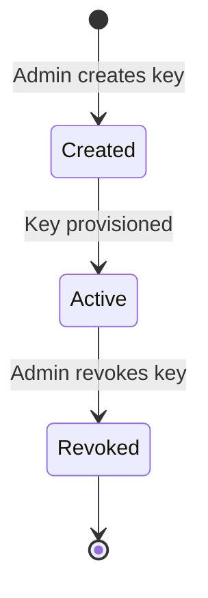
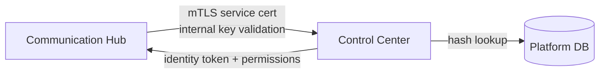

# API Key Security

## Overview

API keys provide an alternative authentication credential for external third-party AI agents (Claude Code, Cursor, custom agents) connecting to the Communication Hub. Keys now authenticate the standard MCP protocol handshake (SSE + Streamable HTTP) in addition to the existing REST skills-loading endpoint. Keys are provisioned by platform administrators in Control Center and validated over existing mTLS service certificates — no new trust model is introduced. The permission model and identity-token isolation are unchanged.

**Tenant binding**: under multi-tenancy, API keys are issued and validated per tenant — key validation resolves the owning tenant from the request's tenant context, and the resulting MCP session is bound to that tenant. A key cannot authenticate to, or reach resources of, any other tenant; key lifecycle and authentication events carry tenant attribution in audit logs. See [Multi-Tenancy Architecture](../multi-tenancy.md).

**Parallel OAuth path**: the same MCP server also accepts the *user's* OIDC Bearer token, which authenticates the session as that user and carries the user's own permission scope. API keys and OAuth tokens are distinguishable credentials with separate session scopes; management tooling is governed by per-tool permission parity on either path. See [Control Center Assistant Security](control-center-assistant.md).

## Key Lifecycle

| State | Description |
|-------|-------------|
| **Created** | Key generated, hash stored, clear-text shown once to admin. Not yet usable. |
| **Active** | Key can authenticate external agents. Validation succeeds, identity token and permission set are returned to CH. |
| **Revoked** | Key permanently invalidated. Any authentication attempt with a revoked key returns 401. |

Keys cannot be re-activated once revoked. The clear-text key is shown exactly once at creation time and is never stored — only the SHA-256 hash persists in the database.

## Hashing Approach

API keys are stored using **SHA-256 one-way hashing** in the `agent_api_keys` table:

- At creation, CC generates a cryptographically random key and computes `SHA-256(key)`
- Only `key_hash` is persisted to the database; the clear-text key is returned once and discarded
- At validation time, CH sends the hashed key (computed from the `Authorization: Bearer` or `?apiKey=` value it received) to CC's internal validation endpoint
- CC performs a hash comparison lookup against `agent_api_keys.key_hash`
- Invalid or revoked keys return 401 with no distinguishing error — preventing key enumeration

No encryption at rest is applied beyond the hash, as the clear-text key is never stored.

## Audit Logging

All API key lifecycle events are recorded in the `ApiKeyUsageLog` table for governance audit:

| Event | Logged Data |
|-------|-------------|
| **Key Created** | Admin identity, bound agent identity + role, timestamp |
| **Key Revoked** | Admin identity, key reference, timestamp |
| **Authentication Attempt** | Key hash (or masked prefix), outcome (success / invalid / revoked), timestamp |
| **Key Used** | Key reference, accessed tool/skill/SOP, timestamp |

Audit logs are immutable and retained per the platform's governance retention policy.

## Transport Security

All communication between Communication Hub and Control Center for API key validation uses the **existing mTLS service certificate infrastructure**. No new certificates or trust relationships are introduced:

The internal validation endpoint is restricted to the Communication Hub caller scope, enforced by mTLS service certificate validation at the edge. External agents cannot call this endpoint directly.

## Two Credential Classes

Third-party [agent integration](../product/features/third-party-agent-integration.md) introduces a second, separate credential class. The two classes are distinct and governed independently:

| | **API Keys** | **Clients** |
|---|---|---|
| Purpose | Authenticate an external agent to the MCP protocol surface | Grant a third party access to one agent type's input interface |
| Identity | Bound to an agent identity + role (identity credential) | **Not** an identity — no tool access, no impersonation |
| Credential types | API key (hashed, shown once) | Secret (server-to-server) or publishable (browser-safe, origin-allowlisted) |
| Use case | Third-party AI agents calling tools/skills/SOPs | Embedded white-label chatbots, request/response integrations, server-to-server agent use |

API keys (identity credentials) are **unchanged** by third-party agent integration. Clients are a non-identity credential class: they carry no agent identity, inherit no role permission set, and can never authenticate to the MCP protocol server — only to the client-invocation gateway.

## Permission Model

API keys do not define their own permission scope. They inherit the **full permission set** of the bound identity + role:

`API Key → bound agent identity → bound agent role → policy evaluation → allowed tools/skills/SOPs`

To restrict an external agent's access, administrators assign a narrowly-scoped role when creating the key. The permission resolution chain is identical to that used by internal Agent Runtime agents — the API key simply provides an alternative entry point.

## Two Credential Classes

Parthenon distinguishes two credential classes entering through the Communication Hub:

| Class | What it authenticates | Capability |
|---|---|---|
| **API Keys** | An agent **identity** (+ role) | MCP tool access (`tools/list` / `tools/call`) with the bound identity's permission set |
| **Clients** | Access to an agent type's **input interface** (conversational turn or typed submit) | Third-party invocation of the agent type — **not** an identity |

- A client is **not an identity**: it receives no agent identity token, cannot list or call MCP tools, cannot reach the MCP hub, and cannot impersonate an agent. The target agent type runs with its own identity + role exactly as configured.
- Client credentials come in two types: **`secret`** (server-to-server) and **`publishable`** (browser-safe).
- **Publishable keys** are safe for browser embedding. Abuse is mitigated per client with an **origin allowlist** enforced at the Communication Hub edge plus a **per-client rate limit** — not by secrecy of the credential.
- A `secret` client may additionally carry an optional end-user token (server-side dual identity); the publishable path carries no user identity.
- Both API keys and clients are tenant-scoped; lifecycle and authentication events carry tenant attribution in audit logs.

See [Third-Party Agent Integration](../modules/third-party-agent-integration/architecture.md) for the integration architecture.
