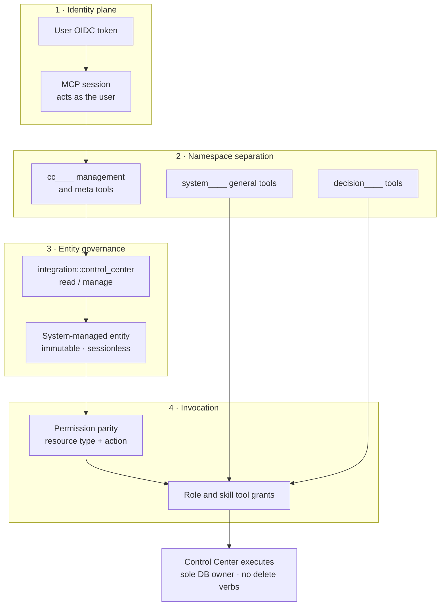

# Control Center Assistant Security

The Control Center Assistant performs real management writes from natural language, so its security model is layered: identity, namespace, entity governance, invocation, and execution each add an independent control. No single layer is the only defence.

| Layer | Control | Guarantee |
|---|---|---|
| **Identity plane** | The user's own OIDC token authenticates the MCP session | The session's scope *is* the user's scope; no service-account or elevated identity |
| **Namespace separation** | Management tools live in the reserved `cc` namespace on a dedicated per-tenant entity | Management capability is grantable independently and cannot ride on a generic system-tool grant |
| **Entity governance** | `integration::control_center` (`read` / `manage`) plus a system-managed lifecycle | Only permission holders can see or define the entity; nobody can mutate it |
| **Invocation** | Permission parity plus role/skill tool grants, checked at listing *and* at call | An MCP call can never perform an action the REST equivalent would deny |
| **Execution** | Control Center is the only database writer; no delete verbs exist | Service segregation holds and destructive operations are impossible by construction |

## User-Scope Execution, Not Delegation

Identity comes from the authenticated session, not from a delegation anchor passed along with the request.

- The in-app assistant and an external MCP client presenting the same user's token have **identical authority** — there is one tool surface and one permission decision.
- Attribution is server-derived from the authenticated session; it is never asserted by the agent or the conversation record.
- The user's identity token is held by Communication Hub for the request lifetime and **never handed to the agent**, which sees only tool results.
- Sensitive material — identity tokens, database credentials, decrypted MCP and provider credentials — never crosses a service boundary and is never echoed into a conversation reply.

## Namespace and Entity Separation

- **Reserved namespaces** — `cc` joins `system` and `decision` as reserved MCP server slugs, so no customer-registered server can collide with management tooling.
- **Dedicated entity** — each tenant owns a Control Center MCP entity hosting the management and meta tools; general system tools stay on the System entity.
- **System-managed lifecycle** — the seeder is the only writer. Update, delete, sync, and OAuth configuration are refused for **everyone**, including `manage` holders and wildcard administrators: immutability is a lifecycle property, not a permission question. The entity is **sessionless** — access flows only through role and skill grants.
- **Grants stay possible** — granting or revoking its tools to roles remains governed by the `manage` action, so administrators can delegate management capability without editing the entity.

## Visibility, Immutability, and Parity

| Concern | Control |
|---|---|
| Who can see the entity and its tools | `integration::control_center:read` — deny-by-default; `integration::*` and `*::*` cover administrators |
| Who can grant/revoke its tools and configure around it | `integration::control_center:manage` |
| Who can change the entity itself | Nobody (system-managed) |
| Who can invoke a management tool | Tool grants **plus** per-tool parity against the resource type and action |
| Referenced dependency | A `cc` tool already bound by a tenant skill stays visible read-only to non-permission holders so a save cannot silently drop it |

The entity permission governs the **administration** surface (seeing and defining the integration); tool invocation remains governed by grants plus parity. A missing entity permission therefore never becomes a silent invocation bypass.

The full resource-family → permission map is in [Control Center Architecture](../modules/control-center/architecture.md).

## No Elevated Path, No Destructive Operations

- There is **no** service-credential route into management operations: every write is executed as the authenticated user, and Control Center re-checks parity before mutation.
- **Deletion is not registered** as a tool at any layer. Delete-shaped or out-of-scope requests receive a fixed "not supported" result before any write, and the same boundary is stated in the assistant's knowledge and instructions so it is never proposed.
- **Fail closed** — unknown resource types are denied before evaluation, invalid or expired tokens are rejected, unresolvable tenants are refused, and an unanswered approval resolves as "not executed" rather than as success.
- **Approval cannot double-execute** — a replayed intervention request is de-duplicated and an already-answered one returns the stored operator response.

## Audit Surface

- Every management action lands in Control Center under the authenticated user, so the existing governance and audit trail covers assistant-driven changes exactly like UI-driven ones.
- Conversation turns, intervention requests, and responses are persisted in order, giving a replayable record of what was proposed, approved, and executed.
- Tool-call activity is reported to Control Center for observability; the agent never writes audit records itself.
