# System Overview

## Service Segregation Invariants

Four rules hold for every diagram and flow in this folder. They are not negotiable by feature design:

- **Three fully segregated backend services** — Control Center, Agent Runtime, and Communication Hub, each with one job.
- **Agents run only in Agent Runtime** — including every conversational turn, optimization-mode conversation, sandboxed script, and approved live optimization test.
- **Only Control Center connects to the database** — every other service reaches state through Control Center's internal API. Agent Runtime holds no datastore, and Communication Hub gains no data access.
- **Agents never receive sensitive data** — identity tokens, database credentials, and provider secrets stay outside Agent Runtime; tokens are injected per tool call by Communication Hub, and model/authoring identifiers cross service boundaries as identifiers only.

## Infrastructure & Configuration

The setup tool is an operator-invoked component that provisions external infrastructure before the runtime services start. It is not part of the running system — it runs once during environment initialization and is safe to re-run (all operations are idempotent).

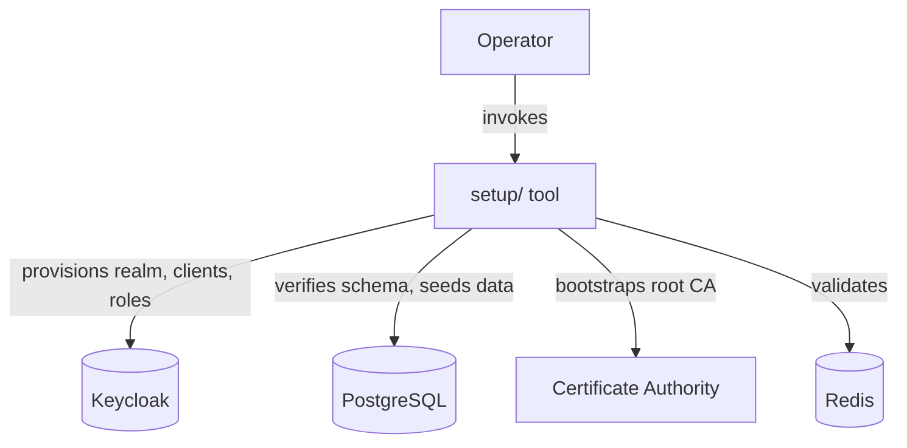

### Runtime Startup Validation & Configuration Resolution

At startup, each service validates that external infrastructure is reachable. Configuration is resolved in priority order: environment variables (primary), YAML config files (fallback), and built-in defaults (last resort). On startup, every service logs which source was used for each infrastructure connection.

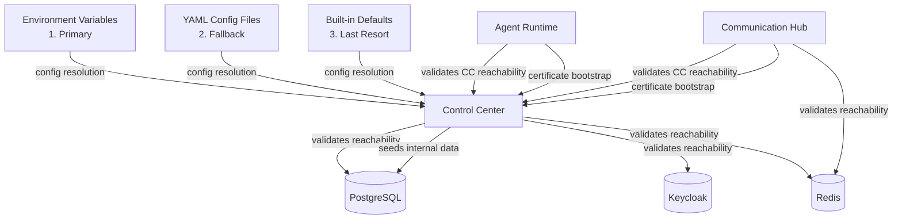

## Workflow Execution

Agent workflows execute through a script-first strategy with unconditional
LLM fallback: when a serving, sandbox-validated script version exists for
the workflow, Agent Runtime executes model-authored sandboxed Python
(RestrictedPython, MCP-only egress, resource caps) instead of the LLM loop;
any sandbox violation or resource-cap breach falls back to the LLM path with
a recorded reason — a run never fails solely because a script failed. The
composition follows a **two-layer plan model**: the base implementation plan
stays a plain high-level step list, while a **separate Optimize action** —
never an option on Run — authors the optimized composition (script segments,
LLM bridges, output decision) as a separate `OptimizedImplementationPlan`,
served only while fresh.

Run and Optimize are independent operator actions. A normal Run uses the
agent's own instructions on the agent's runtime model and never becomes an
optimization mission; Optimize is gated (a successful execution and a usable
authoring model are both required) and executes as a dedicated command
mission. All plan authoring — Skill/SOP workflow generation, implementation
plans, optimized plans — runs on **one workspace authoring model**, a
tenant-scoped setting resolved by Control Center and never the agent's
runtime model; generation happens only on explicit request. A ready plan
whose script later fell back is marked `requires_fix` with recorded feedback
and is never re-served. Absent, stale, retired, or requires-fix plans fall
back to the base-plan LLM path.

Optimization is also available as a human-gated **optimization-mode
conversation on the agent type itself** — no separate optimizer agent,
identity, or role: the conversation *is* the agent type, with its own role
and tool grants. It runs on a tenant-scoped **optimizer model** that falls
back to the authoring model when unset — never the agent's runtime model.
Reference-transcript replay is the default verification, and a live
verification is one explicitly approved script run under the agent's own
identity, consumed once. In test environments the LLM Mock Layer
(`LLM_MOCK_MODE`) serves deterministic model responses so runs complete with
zero LLM API usage.

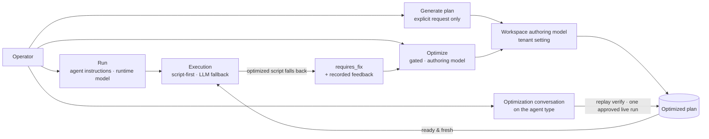

See [Sandboxed Scripting](modules/sandboxed-scripting.md).

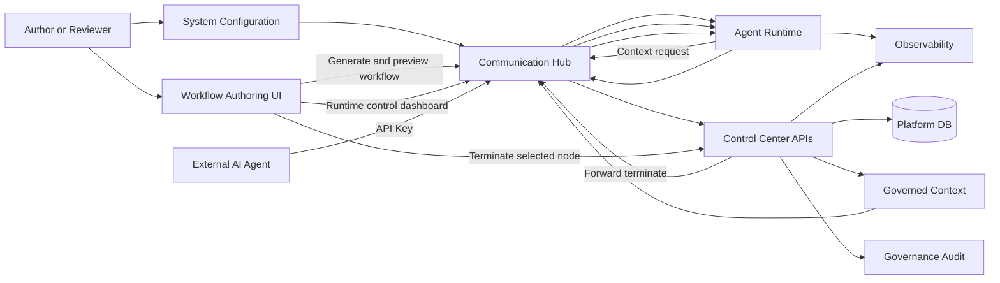

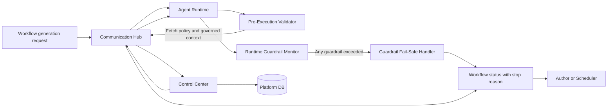

## Multi-Tenancy

One shared deployment serves many organizations (tenants) with hard logical isolation. A **tenancy platform switch** (default OFF) gates all tenant features; when off, the deployment resolves to the **root tenant** (workspace `root`) — a one-tenant world that preserves legacy behavior. The root tenant hosts platform staff and holds the migrated legacy global roles; it is a tenant like any other, not a separate plane. Tenant context is established once per request from a verified source (tenant address subdomain, or tenant header for API/MCP clients), enforced centrally in Control Center (the sole database gateway), and propagated read-only to Agent Runtime and Communication Hub over the existing mTLS channels as signed headers that cannot be widened. Self-serve registration creates a tenant, a platform-issued owner account, and an immutable tenant root membership atomically; license tiers (free / team / enterprise) govern quotas for users, agent types, and monthly executions — with Control Center as the single decision point. For the full module architecture, see [Multi-Tenancy Architecture](modules/multi-tenancy.md).

### Strict Tenant Isolation (Cross-Cutting Property)

Tenant isolation is strict and **fail-closed** end to end (as-built):

- **Mandatory signed internal headers** — every CC↔CH↔AR internal call carries HMAC-signed `X-Internal-Tenant-Id/Slug/Timestamp/Signature` headers. On `/api/v1/internal/*` data-plane endpoints these are mandatory: missing, stale, or invalidly signed requests are rejected with 401 before any handler or database access (no verify-if-present fallback). With multi-tenancy off, header-less internal calls bind the root tenant instead of failing.
- **Single signing origin** — Control Center is the only origin that signs internal tenant headers. Communication Hub and Agent Runtime are **forward-only receivers**: they verify and forward, never sign. All CH/AR → CC internal HTTP goes through the shared `internal_httpx_client` egress choke point (`app/core/internal_http.py`), which automatically forwards the tenant headers. The WS chat path in CH authenticates both OIDC and platform-account tokens, binds the tenant context from the token's tenant claim, mints per-call signatures, and delegates to AR with forwarded headers.
- **Retired concepts** — the NULL-tenant "shared slot" (shared data types, NULL-tenant seeded skills, shared recipient groups) and the platform-wide MCP tool registry no longer exist; legacy NULL-tenant rows were adopted into the root tenant, and MCP server slugs are unique **per tenant** with tools namespaced per tenant (`tools/list` / `tools/call` on the CH MCP protocol server are per-tenant).
- **Login/identity plane** — per-tenant IdP resolution is strict: a tenant validates against its **own provider slot only** (no shared/root chain); tenancy OFF resolves the root slot. Decision-provider vendor differences are abstracted behind a multi-provider client factory, so provider backends are selected per resolved tenant and per selected model, not hard-wired.

For the full isolation invariants, see [Multi-Tenancy Architecture](modules/multi-tenancy.md).

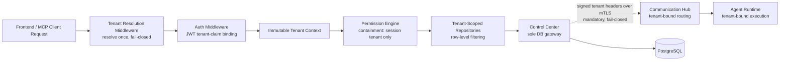

For the MCP hub, tool naming (`server____tool` / `agent____<slug>` unchanged on the wire) and resolution are tenant-qualified at lookup time against the calling tenant's registry — see [MCP Hub Architecture](modules/mcp-hub/architecture.md).

## Authentication Paths

The Communication Hub serves as an MCP endpoint for both internal and external agents. Internal Agent Runtime instances authenticate via mTLS certificates; external third-party AI agents use API keys. A third path authenticates the MCP session **as the user** when a client presents the user's own OIDC Bearer token — that session's permission scope is the user's own scope, with no elevated identity. For external clients, CH exposes a standard MCP protocol endpoint (SSE + Streamable HTTP) in addition to the existing REST skills-loading endpoint — all fronted by the same authentication layer. In every case, identity tokens are held exclusively by the Communication Hub — agents never receive them directly. For full architecture, see [Communication Hub Architecture](modules/communication-hub/architecture.md).

### Third-Party Agent Integration (Client Path)

A second, client-based external path lets third parties consume an agent type's *input interface* (conversational turn or typed submit) through the Communication Hub governed surface. It uses **client credentials** of two classes — `secret` (server-to-server) and `publishable` (browser-safe) — which are **distinct from API keys**: a client is not an identity, receives no agent identity token, cannot call MCP tools, and cannot impersonate an agent. The target agent type always runs with its own identity + role exactly as configured. For full architecture, see [Third-Party Agent Integration](modules/third-party-agent-integration/architecture.md).

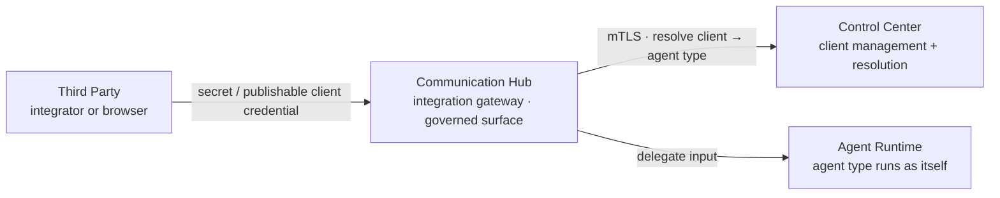

## Example External MCP Server — Airline Booking Demo

The platform ships a standalone **MCP demo app** that registers itself with the MCP Hub like any third-party server and exposes a scenario-based airline booking toolset (search flights, book, payment link, ticket status, check-in, seat selection, cancel) over its own in-memory seed data. It is a demo/validation surface, not a platform component: no Parthenon database row describes a booking, the demo app's state lives and resets in its own process, and every call still travels the governed path (agent in Agent Runtime → Communication Hub → permission resolution in Control Center → the external server). The same scenario is driven from the platform chat surface and from the agent client demo app, and its multi-step check-in capability is the canonical example of a scripted/optimized plan executing in the sandbox while consuming MCP tools.

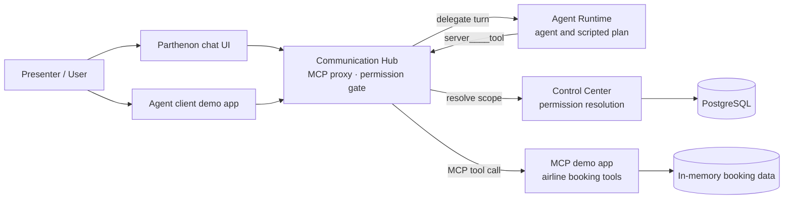

See [MCP Demo App](modules/mcp-demo-app/architecture.md) and [MCP Hub Architecture](modules/mcp-hub/architecture.md).

## Permission Authorization

Parthenon uses a **deny-by-default** authorization model with **policy-based allow**. The Permission Engine resolves effective permissions through a role → policy → resource type chain using the `module::submodule` naming convention. Permissions are **contained within the session's resolved tenant**: every grant (including wildcards) is evaluated only inside the session's tenant — global tenant-less roles no longer exist (legacy global roles migrated into the root tenant), so a tenant user can never hold `platform::` grants that exist only in the root tenant's role space. For the full authorization flow, wildcard evaluation rules, and policy management architecture, see [IAM Module Architecture](modules/iam.md).

## Control Center Assistant

The Control Center Assistant is a seeded, system-provided conversational agent type that performs Agents-menu management tasks (create / update / read of skills, SOPs, agent types, roles, identities, model configurations, schedules, data types, and MCP Hub connections) from natural language. It is an ordinary agent: it runs in Agent Runtime and reaches management capability only as MCP tools on a dedicated per-tenant Control Center entity, authenticated by the *user's* OAuth token, so its permission scope is the user's own scope. Every write is previewed and approved by the operator first, and deletion is not registered as a tool. Conversational management reaches **full parity with the web UI edit surface**: routing carries the complete field set each resource family accepts, payloads are validated with structured, actionable errors the agent can self-correct from, and per-tool permission parity is unchanged. The overall service topology is unchanged — no new service is introduced.

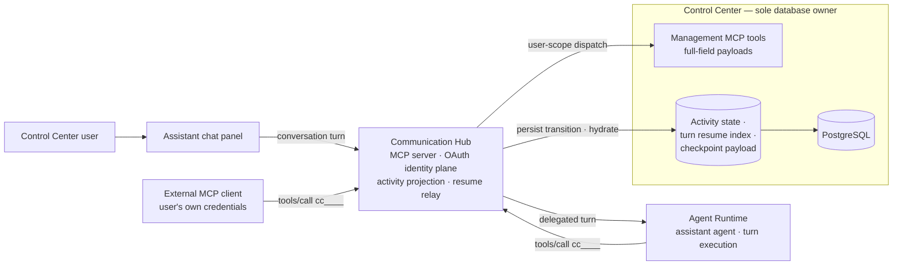

For the module detail see [Control Center Architecture](modules/control-center/architecture.md) and the layered model in [Control Center Assistant Security](security/control-center-assistant.md).

## Conversational Turn Ownership

A conversational turn is owned by Control Center, executed by Agent Runtime, and transported by Communication Hub — so a turn's state never lives only in a process that can restart.

- **One authoritative activity state** — Control Center is the sole owner and writer of what the assistant is doing right now (`thinking` / `using_tool` / `delegating` / `waiting for input` / `finished`, plus the terminal `failed` and `timed out`). Agent Runtime forwards transitions inside its response to the hub; only the hub forwards them to Control Center. Communication Hub keeps a read-through projection, hydrates the current state for a reconnecting or fresh client, and no longer holds the source of truth.
- **One durable pause** — a paused turn is a **Control Center-owned resume index** (lifecycle, pending intervention, validity window, terminal outcome) beside an **opaque checkpoint payload**; Agent Runtime produces and reloads that payload through the existing internal API and claims the turn before continuing, so any instance can resume and only one does. Agent Runtime remains a courier: no datastore, no credentials, no new dependency.
- **One dispatch** — duplicate operator responses collapse into a single resume, and a confirmed write applies at most once. A turn that genuinely cannot be continued resolves terminally with one actionable message, so "waiting for your input" never coexists with an unresumable turn.

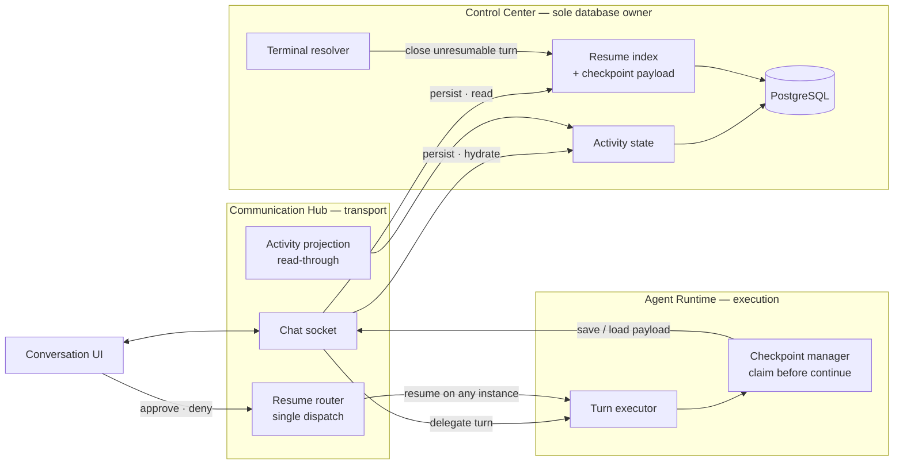

Because ownership is centralized, a paused confirmation survives a restart, failover, or instance replacement: it stays actionable on reconnect until its validity window closes, and a turn that dies mid-flight is resolved to a terminal failure with an actionable message rather than an endless indicator. The state and intervention lifecycles are in [Agent Lifecycle](modules/agent-lifecycle.md); the per-service views are in [Control Center](modules/control-center/architecture.md), [Agent Runtime](modules/agent-runtime/architecture.md), and [Communication Hub](modules/communication-hub/architecture.md).

## Authentication Pipeline

The Control Center establishes the tenant context once per request (fail-closed in multi-tenant mode), then applies a three-tier authentication pipeline — super-admin break-glass auth at the root workspace (top tier), per-tenant OIDC JWT validation (middle tier, tenant claim bound to the resolved tenant), and public path fallback (bottom tier; the public registration endpoint group is the only switch-gated exemption). Platform-issued owner accounts (email + password) authenticate independently of the per-tenant OIDC registry. For the full pipeline architecture, component responsibilities, and OIDC provider modes, see [Control Center Architecture](modules/control-center/architecture.md) and [Identity](modules/identity.md).

## Decision Model Providers

Decision tooling generalises the former single "System One Provider" into multiple **Decision Model Providers** (vendors). Provider configuration, encrypted credentials, model enablement, guardrails, budgets, and usage metering live **only in Control Center** — the sole database-connected service. Each Decision Tool references one enabled Decision Model; the Decision Engine resolves that per-tool selection at execution time, and execution logs capture provider/model identity for audit. Decision model evaluations pass the **same pre-call guardrail and budget/spend checks as regular agent model calls** (including guardrails attached via `model_guardrail_configurations` with the `decision_provider` config source); Agent Runtime and Communication Hub never touch provider credentials or the database — decision execution routes through Control Center internal endpoints. For the full module architecture, see [Decision Models Architecture](modules/decision-models/architecture.md).

### Decision Tools as a Second Decision-Making Pathway

Decision tools are the second decision-making pathway in Parthenon, alongside LLM-backed skills: instead of routing a judgment to an LLM inside a skill, a skill (or an agent, or an external MCP client) calls a user-definable **decision tool** that behaves exactly like a built-in system tool. Decision tools are authored per tenant (names unique per tenant), resolve through the same system-tool registry, permission model, and grants, and are exposed over MCP with the canonical `decision____<name>` prefix — sharing the `server____tool` four-underscore convention with `system____` tools. `decision` is a reserved MCP server slug alongside `system` and `cc`, so no external MCP server can collide with the namespace. Skills themselves are unchanged by this pathway. The TypeSafe System One API (and future decision vendors) is an external system reachable **only from Control Center**, for both execution calls and the lightweight test-connection probe; the provider API key is decrypted at call time in Control Center only and is never returned by any API.

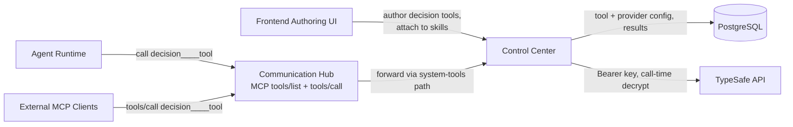

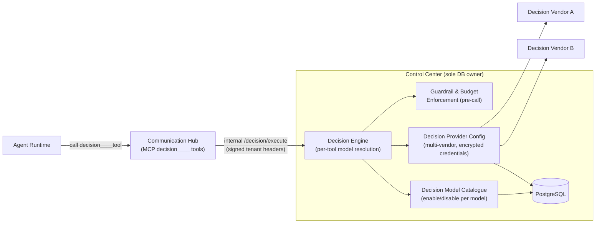

## Token Expiry Alerting

Control Center owns token expiry state end to end via the **Token Health Service** — the sole DB reader of token metadata — classifying agent identity and MCP session **refresh tokens** as `expired` / `expiring-within-7-days` / `healthy`. Access-token expiry is not an alert state while the refresh token remains valid (access tokens renew automatically); entities with no refresh token fall back to access-token expiry, and MCP `requires_reauth` always maps to `expired`. A **preflight gate** in the Communication Hub Agent Gateway validates every refresh-token credential an execution (including subagents) will use before it starts: expired refresh tokens **block** (422, re-auth message), expiring-soon **warns** without blocking. The dashboard shows token health cards, and the topology view is enriched client-side with warning/error badges via the dashboard token-health endpoint. Agents never receive tokens; the Gateway Lifecycle Handler in Control Center is unchanged.

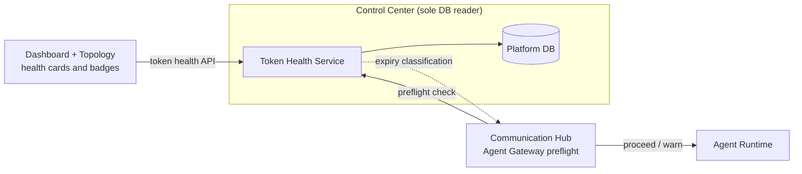

See [Token Refresh Service](modules/token-refresh.md), [Communication Hub Architecture](modules/communication-hub/architecture.md), and [Dashboard](modules/dashboard.md).

## Key Responsibilities

- **Control Center** — Central authority for configuration, authentication, tenant resolution and enforcement (sole database gateway, including tenant-scoped queries and quota usage counting), per-tenant OIDC provider registry, permission resolution, certificate authority, API key management, agent data type registry, agent outputs, the Software 3.0 **script registry** (lifecycle, lineage, serving of validated compositions to Agent Runtime), and scheduling. Owns the **conversational turn**: the persisted, authoritative activity state (with a terminal resolver that closes stale or unresumable work) and the durable **turn resume index plus checkpoint payload store** that make a paused turn answerable on any instance after a restart. Resolves the workspace **authoring model** and the **optimizer model** (tenant-scoped, optimizer falling back to the authoring model), enforces the Optimize gate, marks a plan `requires_fix` on fallback, and keeps the single-use audit ledger behind approved live optimization tests. Hosts the per-tenant **Control Center MCP entity** and its management MCP tools, which power the conversational assistant strictly within the signed-in user's permission scope at full web-UI field parity. Validates infrastructure dependencies at startup and fails fast. It is the **only signing origin** for internal tenant headers and the only issuer of new tenant bindings on internal calls.
- **Agent Runtime** — Deep agent execution via LangChain with tool call orchestration through Communication Hub. Executes workflows **script-first with unconditional LLM fallback**: a fresh, sandbox-validated optimized composition runs as a sandboxed script; any sandbox violation or resource-cap breach falls back to the LLM path with a recorded reason (see [Sandboxed Scripting](modules/sandboxed-scripting.md)). Runs a dedicated **Optimize command execution** separately from normal runs (the authoring model arrives as an execution-context identifier, never credentials), and reports a fallback attributed to an optimized artifact so Control Center can mark the plan `requires_fix`. Runs the seeded conversational assistant and every conversational turn, including **optimization-mode conversations** (routed to the conversational loop regardless of the agent type's input type; replay verification by default, one approved live script run under the agent's own identity). Produces and reloads **durable paused-turn checkpoints as a courier** and claims a turn before continuing it — no datastore, no credentials, no new infrastructure dependency. Injects the inherent self-context / workflow-optimization skills into every agent without per-agent configuration. Enforces delegation depth limits, performs typed output validation, and emits delegation status events. Executes strictly within the signed tenant context received from Control Center — the tenant is resolved once from the signed execution context (fail-closed) and applied to **all** tool, MCP, and A2A resolution and every downstream internal call during the run; scope cannot be widened, and no quota logic runs here. Agents never hold identity tokens.
- **Communication Hub** — Message broker and agent gateway supporting parallel authentication (mTLS cert, tenant-bound API key, and the user's OAuth Bearer token for the management surface). Exposes a standard MCP protocol endpoint (SSE + Streamable HTTP) in addition to the REST skills-loading endpoint; the MCP protocol server's `tools/list` / `tools/call` are **per-tenant** — a client sees and calls only the namespaced tools its own scope permits. Runs the conversational WebSocket flow: binds the tenant from the verified token, delegates turns to Agent Runtime, keeps long turns alive with heartbeats and a turn watchdog, **projects and hydrates the authoritative activity state** owned by Control Center instead of holding status itself, and **routes interventions and resumes to any Agent Runtime instance able to load the paused turn**, collapsing duplicate responses into a single dispatch. It gains no data access and no signing rights — it remains a forward-only receiver. Routes tool calls, agent sessions, and A2A messages strictly within the tenant context received from Control Center; cross-tenant routing is impossible.
- **Setup Tool** — Operator-invoked CLI (outside running system) for Keycloak provisioning, certificate authority bootstrap, and database seeding. All operations are idempotent.
