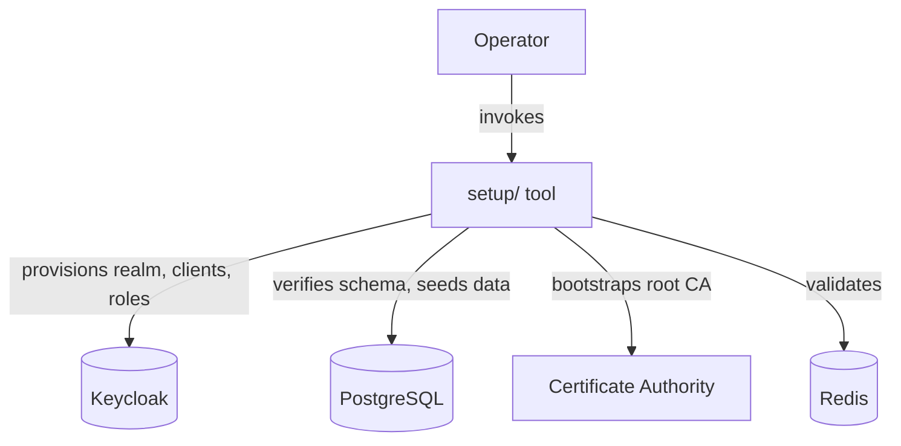
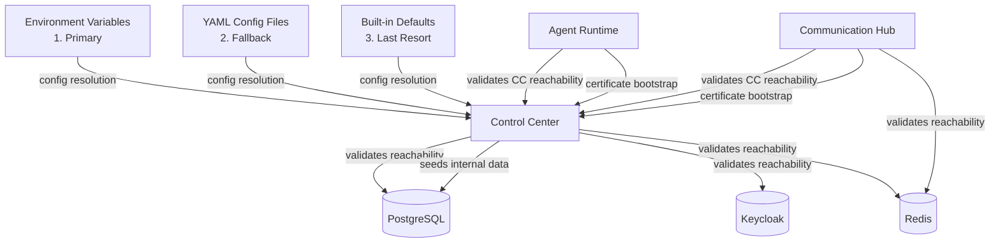
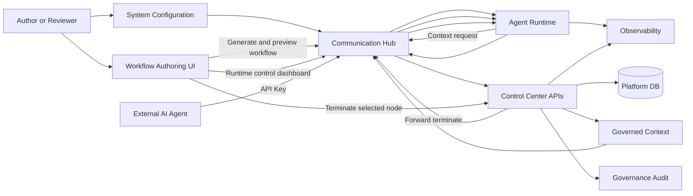
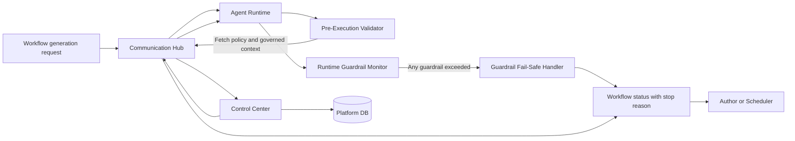
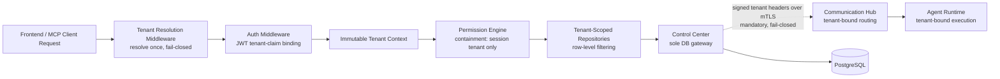
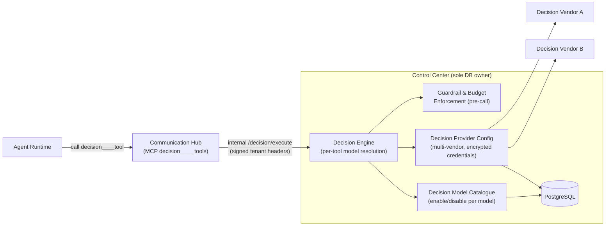

# System Overview

## Infrastructure & Configuration

The setup tool is an operator-invoked component that provisions external infrastructure before the runtime services start. It is not part of the running system — it runs once during environment initialization and is safe to re-run (all operations are idempotent).

### Runtime Startup Validation & Configuration Resolution

At startup, each service validates that external infrastructure is reachable. Configuration is resolved in priority order: environment variables (primary), YAML config files (fallback), and built-in defaults (last resort). On startup, every service logs which source was used for each infrastructure connection.

## Workflow Execution

## Multi-Tenancy

One shared deployment serves many organizations (tenants) with hard logical isolation. A **tenancy platform switch** (default OFF) gates all tenant features; when off, the deployment resolves to the **root tenant** (workspace `root`) — a one-tenant world that preserves legacy behavior. The root tenant hosts platform staff and holds the migrated legacy global roles; it is a tenant like any other, not a separate plane. Tenant context is established once per request from a verified source (tenant address subdomain, or tenant header for API/MCP clients), enforced centrally in Control Center (the sole database gateway), and propagated read-only to Agent Runtime and Communication Hub over the existing mTLS channels as signed headers that cannot be widened. Self-serve registration creates a tenant, a platform-issued owner account, and an immutable tenant root membership atomically; license tiers (free / team / enterprise) govern quotas for users, agent types, and monthly executions — with Control Center as the single decision point. For the full module architecture, see [Multi-Tenancy Architecture](modules/multi-tenancy.md).

### Strict Tenant Isolation (Cross-Cutting Property)

Tenant isolation is strict and **fail-closed** end to end (as-built):

- **Mandatory signed internal headers** — every CC↔CH↔AR internal call carries HMAC-signed `X-Internal-Tenant-Id/Slug/Timestamp/Signature` headers. On `/api/v1/internal/*` data-plane endpoints these are mandatory: missing, stale, or invalidly signed requests are rejected with 401 before any handler or database access (no verify-if-present fallback). With multi-tenancy off, header-less internal calls bind the root tenant instead of failing.
- **Single signing origin** — Control Center is the only origin that signs internal tenant headers. Communication Hub and Agent Runtime are **forward-only receivers**: they verify and forward, never sign. All CH/AR → CC internal HTTP goes through the shared `internal_httpx_client` egress choke point (`app/core/internal_http.py`), which automatically forwards the tenant headers. The WS chat path in CH authenticates both OIDC and platform-account tokens, binds the tenant context from the token's tenant claim, mints per-call signatures, and delegates to AR with forwarded headers.
- **Retired concepts** — the NULL-tenant "shared slot" (shared data types, NULL-tenant seeded skills, shared recipient groups) and the platform-wide MCP tool registry no longer exist; legacy NULL-tenant rows were adopted into the root tenant, and MCP server slugs are unique **per tenant** with tools namespaced per tenant (`tools/list` / `tools/call` on the CH MCP protocol server are per-tenant).
- **Login/identity plane** — per-tenant IdP resolution is strict: a tenant validates against its **own provider slot only** (no shared/root chain); tenancy OFF resolves the root slot. Decision-provider vendor differences are abstracted behind a multi-provider client factory, so provider backends are selected per resolved tenant and per selected model, not hard-wired.

For the full isolation invariants, see [Multi-Tenancy Architecture](modules/multi-tenancy.md).

For the MCP hub, tool naming (`server____tool` / `agent____<slug>` unchanged on the wire) and resolution are tenant-qualified at lookup time against the calling tenant's registry — see [MCP Hub Architecture](modules/mcp-hub/architecture.md).

## Authentication Paths

The Communication Hub serves as an MCP endpoint for both internal and external agents. Internal Agent Runtime instances authenticate via mTLS certificates; external third-party AI agents use API keys. For external clients, CH exposes a standard MCP protocol endpoint (SSE + Streamable HTTP) in addition to the existing REST skills-loading endpoint — both fronted by the same API-key authentication. In both cases, identity tokens are held exclusively by the Communication Hub — agents never receive them directly. For full dual-auth architecture, see [Communication Hub Architecture](modules/communication-hub/architecture.md).

## Permission Authorization

Parthenon uses a **deny-by-default** authorization model with **policy-based allow**. The Permission Engine resolves effective permissions through a role → policy → resource type chain using the `module::submodule` naming convention. Permissions are **contained within the session's resolved tenant**: every grant (including wildcards) is evaluated only inside the session's tenant — global tenant-less roles no longer exist (legacy global roles migrated into the root tenant), so a tenant user can never hold `platform::` grants that exist only in the root tenant's role space. For the full authorization flow, wildcard evaluation rules, and policy management architecture, see [IAM Module Architecture](modules/iam.md).

## Authentication Pipeline

The Control Center establishes the tenant context once per request (fail-closed in multi-tenant mode), then applies a three-tier authentication pipeline — super-admin break-glass auth at the root workspace (top tier), per-tenant OIDC JWT validation (middle tier, tenant claim bound to the resolved tenant), and public path fallback (bottom tier; the public registration endpoint group is the only switch-gated exemption). Platform-issued owner accounts (email + password) authenticate independently of the per-tenant OIDC registry. For the full pipeline architecture, component responsibilities, and OIDC provider modes, see [Control Center Architecture](modules/control-center/architecture.md) and [Identity](modules/identity.md).

## Decision Model Providers

Decision tooling generalises the former single "System One Provider" into multiple **Decision Model Providers** (vendors). Provider configuration, encrypted credentials, model enablement, guardrails, budgets, and usage metering live **only in Control Center** — the sole database-connected service. Each Decision Tool references one enabled Decision Model; the Decision Engine resolves that per-tool selection at execution time, and execution logs capture provider/model identity for audit. Decision model evaluations pass the **same pre-call guardrail and budget/spend checks as regular agent model calls** (including guardrails attached via `model_guardrail_configurations` with the `decision_provider` config source); Agent Runtime and Communication Hub never touch provider credentials or the database — decision execution routes through Control Center internal endpoints. For the full module architecture, see [Decision Models Architecture](modules/decision-models/architecture.md).

## Key Responsibilities

- **Control Center** — Central authority for configuration, authentication, tenant resolution and enforcement (sole database gateway, including tenant-scoped queries and quota usage counting), per-tenant OIDC provider registry, permission resolution, certificate authority, API key management, agent data type registry, agent outputs, and scheduling. Validates infrastructure dependencies at startup and fails fast. It is the **only signing origin** for internal tenant headers and the only issuer of new tenant bindings on internal calls.
- **Agent Runtime** — Deep agent execution via LangChain with tool call orchestration through Communication Hub. Enforces delegation depth limits, performs typed output validation, and emits delegation status events. Executes strictly within the signed tenant context received from Control Center — the tenant is resolved once from the signed execution context (fail-closed) and applied to **all** tool, MCP, and A2A resolution and every downstream internal call during the run; scope cannot be widened, and no quota logic runs here. Agents never hold identity tokens.
- **Communication Hub** — Message broker and agent gateway supporting dual authentication (mTLS cert + tenant-bound API key). Exposes a standard MCP protocol endpoint (SSE + Streamable HTTP) in addition to the REST skills-loading endpoint; the MCP protocol server's `tools/list` / `tools/call` are **per-tenant** — an API-key-authenticated MCP client sees and calls only its tenant's namespaced tools. Routes tool calls, agent sessions, and A2A messages strictly within the tenant context received from Control Center; cross-tenant routing is impossible. Handles conversation intervention routing and WebSocket connections for real-time chat — WS chat authenticates both OIDC and platform-account tokens, binds the tenant from the token's tenant claim, and delegates to Agent Runtime with forwarded signed tenant headers.
- **Setup Tool** — Operator-invoked CLI (outside running system) for Keycloak provisioning, certificate authority bootstrap, and database seeding. All operations are idempotent.
