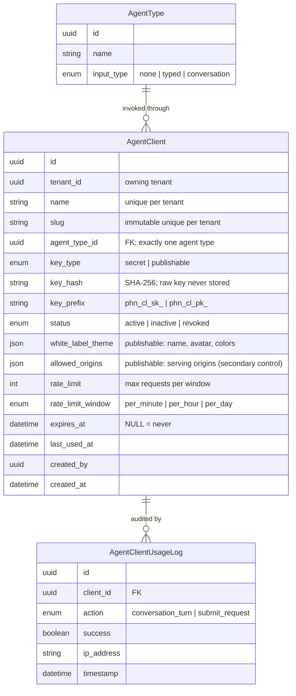

# Agent Management — Entities

[← Data model overview](../../overview.md)

Core agent entities: agent types, roles, identities, plans, sessions, outputs and
their relationships. Adjacent entity groups have their own pages:

| Page | Entities |
|---|---|
| **[Runtime control & guardrails](runtime-control.md)** | Model guardrails, evaluations, usage posture, runtime control, termination and recursion checks |
| **[Software 3.0 scripting](scripting.md)** | Script registry, versions, optimized plans, verification/fallback/repair evidence, LLM mock recordings, command prompts |

Third-party `AgentClient` grants stay on this page (they are a small, tightly
coupled group bound to `AgentType`).

[← Data model overview](../../overview.md)

```mermaid
erDiagram
    ModelConfig {
        uuid id
        uuid tenant_id "mandatory; display_name unique per tenant"
        string name
        enum provider_type "12 providers (OpenAI-compatible + native API); new values are release-led"
        string api_endpoint
        string api_key_encrypted
        json enabled_models
        boolean is_active
        datetime created_at
        datetime updated_at
    }
    AgentRole {
        uuid id
        uuid tenant_id "mandatory; name unique per tenant"
        string name
        string slug
        string description
        datetime created_at
        datetime updated_at
    }
    AgentRoleAllowedType {
        uuid id
        uuid agent_role_id
        uuid allowed_agent_type_id
        datetime created_at
    }
    AgentRoleIdentity {
        uuid role_id
        uuid identity_id
        datetime assigned_at
        uuid assigned_by
        datetime created_at
    }
    AgentRoleSOP {
        uuid role_id
        uuid sop_id
    }
    AgentRoleSkill {
        uuid role_id
        uuid skill_id
    }
    AgentRoleMcpSession {
        uuid role_id
        uuid mcp_session_id
        uuid server_id
        datetime assigned_at
        uuid assigned_by
    }
    AgentIdentity {
        uuid id
        uuid tenant_id "mandatory; name unique per tenant"
        string name
        string slug
        string display_name
        enum identity_type
        string auth_provider
        string realm_name
        string access_token_encrypted
        string refresh_token_encrypted
        string encrypted_refresh_token
        datetime token_expiry
        datetime last_token_refresh_at
        datetime refresh_token_expires_at "nullable; drives expiring (≤7d) vs expired"
        enum last_token_refresh_outcome "success | failure (nullable)"
        enum token_health_state "healthy | expiring | expired | unknown (computed, nullable)"
        enum status
        enum token_status
        datetime created_at
        datetime updated_at
    }
    TokenHealthCheck {
        uuid id
        uuid tenant_id
        uuid agent_type_id
        enum target_kind "agent_identity | mcp_session"
        enum health_state "healthy | expiring | expired | unknown"
        enum check_outcome "passed | blocked"
    }
    AgentType {
        uuid id
        uuid tenant_id "mandatory; name unique per tenant"
        string name
        string slug
        string display_name
        string description
        uuid identity_id "same tenant"
        uuid role_id "same tenant"
        string model_id
        string system_instruction
        enum input_type
        json input_schema
        enum output_type
        json output_schema
        uuid output_data_type_id "optional; linked when output_type=typed"
        boolean is_active
        boolean is_system "system-provided agent type (e.g. Control Center Assistant); protected from user edit/delete"
        datetime created_at
        datetime updated_at
    }
    AgentTypeSopBinding {
        uuid id
        uuid agent_type_id
        uuid sop_id
        int order
        datetime created_at
    }
    AgentTypeSkillBinding {
        uuid id
        uuid agent_type_id
        uuid skill_id
        int order
        datetime created_at
    }
    AgentSession {
        uuid id
        uuid agent_type_id
        uuid triggered_by_user_id
        uuid output_id "optional; convenience link"
        json input_data
        enum status "queued | running | waiting_for_human | completed | failed | terminated"
        datetime started_at
        datetime completed_at
        json output_data
        json conversation_history
        string error_message
        datetime created_at
    }
    InterveneRequest {
        uuid id
        uuid agent_session_id "nullable; NULL for conversation-scoped requests"
        uuid conversation_session_id
        enum intervention_type "approval | choice | text"
        enum status "pending | responded | cancelled | expired"
    }
    InterveneResponse {
        uuid id
        uuid request_id
        uuid operator_user_id
        datetime responded_at
    }
    AgentA2ASessionLink {
        uuid id
        string requester_instance_id
        string receiver_instance_id
        string session_link_id
        boolean receiver_is_dynamic
        enum status
        datetime created_at
        datetime disconnected_at
    }
    AgentData {
        uuid id
        uuid tenant_id "mandatory; get_data matches the calling tenant only"
        uuid agent_type_id
        uuid session_id
        string data_name
        json data_value
        enum data_type
        boolean is_active
        datetime timestamp
    }
    AgentOutput {
        uuid id
        uuid tenant_id "mandatory; get_output/query_result match the calling tenant only"
        uuid data_type_id
        uuid agent_type_id
        uuid execution_session_id
        json field_values "values keyed by field name per the data type schema"
        enum validation_status "valid | validation_error"
        string raw_output "unstructured fallback when validation fails"
        datetime created_at
    }
    AgentDataType {
        uuid id
        uuid tenant_id "mandatory; no platform-shared types"
        string name "unique per tenant"
        string slug "unique per tenant"
        string description
        json fields "typed field definitions; enum fields carry {value, description} entries"
        datetime created_at
        datetime updated_at
    }
    McpServer {
        uuid id
        string name
        string slug
    }
    McpSession {
        uuid id
        uuid server_id
        string name
        json identity_binding
    }
    Sop {
        uuid id
        string name
    }
    Skill {
        uuid id
        string name
    }
    Identity {
        uuid id
        string subject
    }
    ConversationSession {
        uuid id
        uuid agent_type_id
        enum status
    }

    AgentRole ||--o{ AgentRoleSOP : "grants access to"
    AgentRole ||--o{ AgentRoleSkill : "grants access to"
    AgentRole ||--o{ AgentRoleIdentity : "can be assumed by"
    AgentRole ||--o{ AgentRoleMcpSession : "provides MCP context via"
    AgentRole ||--o{ AgentRoleAllowedType : "allows"
    AgentIdentity ||--o{ AgentRoleIdentity : "can assume"
    AgentRoleIdentity }o--|| Identity : "assigned by"
    AgentRoleSOP }o--|| Sop : "references"
    AgentRoleSkill }o--|| Skill : "references"
    AgentRoleMcpSession }o--|| McpSession : "references"
    AgentRoleMcpSession }o--|| McpServer : "constrained by"
    McpSession }o--|| McpServer : "belongs to"
    AgentPlan {
        uuid id
        uuid agent_type_id
        json plan_steps
        json topology
        enum generation_status "pending | success | failed (outcome of one attempt)"
        string generation_error "failure reason; the last successful plan is preserved"
        string agent_config_hash
        boolean fully_scripted "base-plan mark: single-script zero-LLM workflow candidate"
        datetime generated_at
        datetime created_at
        datetime updated_at
    }

    AgentInstanceCertificate {
        uuid id
        uuid agent_type_id
        string instance_id
        enum status "active | expired | revoked"
    }
    TokenRefreshLog {
        uuid id
        uuid agent_identity_id "nullable; one of identity/session per row"
        enum outcome
    }

    AgentType }o--|| AgentRole : "governed by"
    AgentType }o--|| AgentIdentity : "authenticates as"
    AgentSession }o--|| AgentType : "executes"
    InterveneRequest }o--o| AgentSession : "originates from (null for conversation-scoped)"
    InterveneRequest }o--|| AgentType : "initiated by"
    InterveneRequest }o--|| ConversationSession : "surfaced in"
    InterveneRequest ||--o| InterveneResponse : "resolved by"
    InterveneResponse }o--|| Identity : "responded by"
    AgentType ||--o{ AgentRoleAllowedType : "listed as"
    AgentType ||--o{ AgentA2ASessionLink : "participates via runtime instances"
    AgentSession }o--o| Identity : "triggered by"
    AgentType ||--o| AgentPlan : "has current plan"
    AgentType ||--o{ AgentInstanceCertificate : "issues"
    AgentType ||--o{ AgentTypeSopBinding : "binds SOPs via"
    AgentType ||--o{ AgentTypeSkillBinding : "binds skills via"
    AgentTypeSopBinding }o--|| Sop : "references"
    AgentTypeSkillBinding }o--|| Skill : "references"
    AgentIdentity ||--o{ TokenRefreshLog : "logs"
    Tenant ||--o{ TokenHealthCheck : "scopes"
    AgentType ||--o{ TokenHealthCheck : "preflight before execution"
    AgentIdentity ||--o{ TokenHealthCheck : "preflighted as"
    AgentType ||--o{ AgentData : "saves named data"
    AgentSession ||--o{ AgentData : "contains saved records"
    AgentType ||--o{ AgentOutput : "produces final output"
    AgentSession ||--o| AgentOutput : "result stored in"
    AgentDataType ||--o{ AgentOutput : "defines schema for"
    AgentType }o--|| AgentDataType : "output schema defined by"
```

**Sources**: `backend/app/db/models/agents.py`, `backend/app/db/models/token_health.py`, `backend/app/db/models/agent_data.py`, `backend/app/db/models/agent_output.py`, `backend/app/db/models/agent_data_type.py`, `backend/app/db/models/agent_security.py`

> **Canonical homes:** `InterveneRequest`/`InterveneResponse` live in the Communication module; `TokenHealthCheck`/`AgentInstanceCertificate`/`TokenRefreshLog` in the Security module. They appear above as relationship context only.

**Tenant containment:** `ModelConfig`, `AgentRole`, `AgentIdentity`, `AgentType`, `AgentData`, `AgentOutput` and `AgentDataType` carry a **mandatory** tenant reference; names, slugs and display names are unique **per tenant only**. Bindings and role grants are same-tenant only; SOP and A2A delegation **by name** resolve by **(tenant, name)**, so a name collision never routes to the wrong tenant's agent. Data saves and typed output queries match the calling tenant only.

| Entity | Description |
|--------|-------------|
| **ModelConfig** | A named, reusable LLM provider backend configuration. Stores provider type, API endpoint, encrypted credentials, and the explicit list of enabled model IDs. The runtime resolves which config to use by matching a model ID against `enabled_models` on active configs. |
| **AgentRole** | A named permission set granting an agent access to specific SOPs and/or Skills. Controls which MCP tools are available at runtime and which identities may assume the role. |
| **AgentRoleAllowedType** | Explicit allow-list mapping between an agent role and target agent types permitted for delegation. Used for A2A policy preview and enforcement checks. |
| **AgentRoleIdentity** | Join table assigning an AgentIdentity to an AgentRole (an identity may only assume a role recorded here); tracks when and by whom. |
| **AgentRoleSOP** | Join table linking an AgentRole to a Sop. Granting an SOP implicitly includes all Skills it depends on and all MCP tools those Skills require. |
| **AgentRoleSkill** | Join table linking an AgentRole to a Skill directly (outside of any SOP). Contributes the Skill's required MCP tools to the role's allowed tool set. |
| **AgentRoleMcpSession** | Join table giving an AgentRole the credential/resource context of an MCP session (at most one session per server per role). |
| **AgentIdentity** | An agent's user account in a dedicated identity provider realm (e.g. `ai_agents`). Stores encrypted OAuth access/refresh tokens, refreshed automatically; `token_status` (`active`/`expired`/`refresh_failed`) blocks execution when it becomes `refresh_failed`. Token-health fields (`refresh_token_expires_at`, `last_token_refresh_outcome`, `token_health_state`) carry the computed `healthy | expiring ≤7d | expired | unknown` state surfaced on dashboard and topology. Name/slug is the slug-safe runtime identifier; display labels stay user-friendly. |
| **AgentType** | The definition of an agent class: identity, permission role, runtime model, system instruction, and input/output schema. When `output_type` is `typed`, `output_data_type_id` links the `AgentDataType` defining the output contract. `model_id` resolves at runtime against active `ModelConfig.enabled_models` (no direct FK). Slug is the canonical routing key for delegation and protocol metadata. Curated SOP/skill bindings live in `AgentTypeSopBinding` / `AgentTypeSkillBinding`. `is_system = true` marks a **platform-supplied** agent type (e.g. the seeded Control Center Assistant), protected from user edit/delete. |
| **AgentTypeSopBinding** | Join entity binding an AgentType to a Sop at an explicit `order` position (unique per pair); the merged order across SOP and skill bindings drives system-instruction generation and plan context. |
| **AgentTypeSkillBinding** | Join entity binding an AgentType to a Skill at an explicit `order` position (unique per pair), merged with SOP bindings. |
| **AgentSession** | A single agent execution instance from submission through completion — the agent instance record behind the dashboard. Stores input, output, status, timing and, for conversational agents, the full `conversation_history`; provides session context for `get_data`/`get_output`. `output_id` is an optional convenience link to the typed output. Status includes `waiting_for_human` while paused pending an intervene response. |
| **AgentA2ASessionLink** | Tracks A2A requester/receiver linkage for delegated runs. Supports shared-session lifecycle tracking, receiver cleanup decisions, and delegated execution status visibility. |
| **AgentData** | A named, typed record saved via the `save_data` tool; zero or more per session (intermediate, optional), scoped to an AgentType and AgentSession and queried by `get_data`. |
| **AgentOutput** | Immutable record of one typed execution result: agent type + execution session + data type schema, with `field_values` keyed by field name. `validation_status` is `valid` or `validation_error`; `raw_output` keeps the unparsed text as a render fallback when validation fails. |
| **AgentDataType** | Central registry of reusable output schemas: an ordered array of typed field definitions (`fields`) that agent types reference as their output contract. **Enum fields** carry allowed values as `{value, description}` entries (bare strings read as description-less). `slug` is the canonical identifier used by `query_result` at runtime. Tenant-owned (no platform-shared types); name/slug unique per tenant and resolved within the calling tenant. Cannot be deleted while referenced by an agent type or decision tool. |
| **AgentPlan** | The most recent implementation plan for an agent type — one record per `AgentType` (unique on `agent_type_id`). `plan_steps` is an ordered payload, human-readable for preview and machine-parseable for runtime guidance; steps may carry an optional `parent_order` (tree rendering) and optional `type` (non-entity steps are `processing`). `topology` is an opaque node-edge JSON payload rendered by the Topology Builder. `generation_status` (`pending` \| `success` \| `failed`) is the outcome of the **latest attempt**, not a prerequisite: `generation_error` records the failure **without discarding the last successful plan** (steps, topology, config hash, `generated_at` preserved; a failed row is inserted only when no plan exists yet). Authoring is **explicit only** (saving an agent type never schedules it) and uses the **workspace authoring model** (`TenantSetting.workflow_generation_model_id`), never the agent type's runtime `model_id`; no field records which model authored a plan. `agent_config_hash` detects staleness. The Agent Runtime loads the saved plan at session start. |

**Business rules:**
- `AgentType.slug` is the canonical agent routing identifier within its tenant, unique and normalized. A2A and SOP delegation by name resolve targets by **(tenant, name)**.
- Agent identity runtime identifier (name/slug) must be slug-safe for protocol metadata and routing; identities are tenant-owned and identity–role assignments are same-tenant only.
- Role-to-agent-type allow-list mappings are used to preview and enforce delegation boundaries.
- Binding order is shared across both SOP and skill binding types — the merged list sorted by `order` defines the curated capability sequence for plan generation and system instruction context.
- Bound SOPs and skills must be accessible through at least one role assigned to the agent type; validation runs on save and rejects invalid references.
- Only sessions in `running` state may transition to `waiting_for_human`.
- A session in `waiting_for_human` may transition to `running` (resume), `terminated` (operator terminated), or `failed` (system error during resume).
- Multiple concurrent intervene requests per session are not permitted — a duplicate `human_intervene` call while a `pending` request exists returns the existing request ID.
- When a session transitions from `waiting_for_human` to `terminated`, all `pending` intervene requests for that session are automatically marked `cancelled`.
- `AgentDataType.name` and `AgentDataType.slug` must be unique **per tenant**. At least one field is required in `fields`.
- `AgentDataType.slug` is the canonical identifier used by the `query_result` tool at runtime and should be slug-safe.
- When `AgentType.output_type` is `typed`, `output_data_type_id` must be non-null; it must be null for `auto` and `markdown` output types.
- `AgentOutput.validation_status` is `valid` when `field_values` passes schema validation against the referenced `AgentDataType.fields`, `validation_error` otherwise.
- `AgentOutput.raw_output` stores the unparsed agent output as a fallback for UI rendering when validation fails.
- `AgentOutput.field_values` is soft-referenced to the data type schema — the schema is resolved at read time via `data_type_id`.
- **System-provided agent types are protected**: `is_system = true` (only the Control Center Assistant today) is surfaced specially and cannot be modified or deleted; the flag is set by platform seeding only, never by tenant users.
- **The Control Center Assistant is a seeded agent type**: each tenant gets its own `control-center-assistant` row (conversational, `is_system = true`, bound to the `control-center-management` skill and its management MCP tools) — configuration of an `AgentType` plus bindings, not a separate entity.
- **Conversation-scoped interventions**: an `InterveneRequest` raised from a conversational turn carries `agent_session_id = NULL` (no backing `AgentJob`) and resumes from `conversation_session_id`; job-scoped requests continue to set `agent_session_id`.

---

## Third-Party Agent Integration Entities

Clients are access grants to an agent type's *input interface* (conversation turn or typed submit) — not identities. `AgentIdentity`, `AgentApiKey`, and `AgentRole` are **unchanged** by this change: clients are a separate table and a separate credential class from API keys (see the security module). `AgentType` gains only a relationship — `AgentType 1:N AgentClient` (a type may be exposed through many clients; the type's `input_type` selects the integration surface — `conversation` → chat widget, `typed` → request/response).

**Source**: `backend/app/db/models/agent_client.py`

| Entity | Description |
|--------|-------------|
| **AgentClient** | Tenant-owned access grant to exactly one agent type; `key_type` is `secret` (server-to-server) or `publishable` (browser-safe) and is immutable once created. Grants input-interface-only access — cannot list/call tools, cannot reach the MCP hub, and cannot impersonate an agent identity. |
| **AgentClientUsageLog** | Append-only audit record for each client invocation (success and failure); never stores the credential value. |

---

## Agent Execution Data Flow

Saved data (`AgentData`) is intermediate and optional — the `save_data` tool may
be called zero or more times per session. Output (`AgentOutput`) is the final,
singular result per session, produced once at execution completion and validated
against the referenced `AgentDataType` schema. The entities and their
relationships are drawn in the domain diagram above; the flow is
`AgentType` → `AgentSession` → (0..n) `AgentData` → (0..1) `AgentOutput`, with
`AgentDataType` defining the output contract.

**Source**: `backend/app/db/models/agent_data.py`, `backend/app/db/models/agent_output.py`, `backend/app/db/models/agent_data_type.py`
