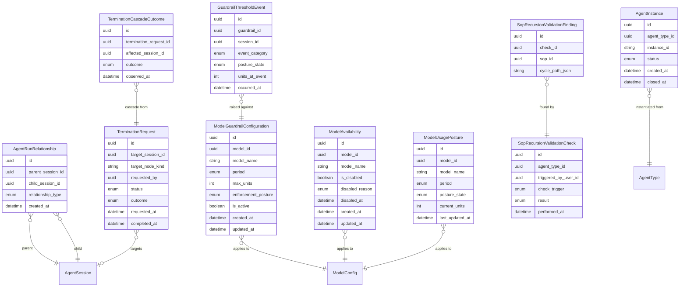

# Agent Entities — Runtime Control & Guardrails

[← Agent entities hub](entities.md) · [Data model overview](../../overview.md)

Model-usage guardrails, evaluation outcomes, usage posture, and the runtime
control / termination / recursion-validation entities.

## Model Guardrail and Runtime Control Entities

The following entities support the **vendor → model → guardrail hierarchy** for model-usage guardrails and the **Runtime Control Dashboard** for live execution visibility and operator-controlled termination.

**Sources**: `backend/app/db/models/model_guardrail_configuration.py`, `backend/app/db/models/model_usage_posture.py`, `backend/app/db/models/model_availability.py`, `backend/app/db/models/guardrail_threshold_event.py`, `backend/app/db/models/agent_run_relationship.py`, `backend/app/db/models/termination_request.py`, `backend/app/db/models/termination_cascade_outcome.py`, `backend/app/db/models/sop_recursion_validation_check.py`, `backend/app/db/models/sop_recursion_validation_finding.py`

| Entity | Description |
|--------|-------------|
| **ModelGuardrailConfiguration** | One guardrail per model per period (hour/day/week/month). `enforcement_posture` is `terminate` (default) or `observe-only`; `is_active` toggles the period independently. |
| **ModelAvailability** | Per-model availability state. `is_disabled=True` blocks execution; `disabled_reason` is `vendor_disabled` (cascade from vendor-level disable) or `model_disabled` (manual). |
| **ModelUsagePosture** | Current usage posture against a guardrail limit. `posture_state` is `within_limit`, `approaching_limit`, or `breached`. When `breached` and the guardrail's `enforcement_posture` is `terminate`, the agent execution is blocked. |
| **AgentInstance** | A logical agent instance in the dashboard; `instance_id` is the canonical key for `AgentInstanceCertificate` lookup. `status` is `created` / `active` / `closed` / `error`. |
| **AgentRunRelationship** | Parent/child edges between `AgentSession` records for delegated execution. The relationship graph is rendered in the runtime topology diagram and walked during cascade termination. |
| **TerminationRequest** | An operator-initiated termination against a session. `target_node_kind` is `agent` (live job) or `conversation` (idle session); `status` is `pending`/`completed`/`failed`, `outcome` `cancelled`/`not_found`/`error`. |
| **TerminationCascadeOutcome** | One row per delegated child affected by a parent termination. Captures whether each child was successfully cancelled, not found, or errored. |
| **GuardrailThresholdEvent** | Append-only log of guardrail threshold transitions. `event_category` is one of `model_disabled`, `vendor_disabled`, `guardrail_breached`. `posture_state` is the new state at the time of the event. |
| **SopRecursionValidationCheck** | Records a recursion/dead-loop risk validation at create, update, or run initiation. `check_trigger` is `create` / `update` / `run`; `result` is `pass` / `fail`. |
| **SopRecursionValidationFinding** | The specific cycle path(s) found by a `SopRecursionValidationCheck`. Stores the cycle path as a JSON array of SOP IDs. |
| **ModelGuardrailEvaluation** | Per-run evaluation outcome for model guardrail policy checks. Records the guardrail configuration, agent job, policy name, evaluated period, threshold value, observed value, posture state, and evaluation outcome (pass/fail/error). |
| **ExecutionLogEntry** | Immutable audit trail of agent session execution events (LLM calls, tool calls, system events, errors). Categorised by event type and actor type; referenced by `agent_job_id` for session-scoped queries. |

**Business rules:**
- A model may have one to four `ModelGuardrailConfiguration` records (one per period); there is no forced four-period entry.
- `ModelAvailability.disabled_reason = vendor_disabled` indicates a cascade from vendor-level disable; the model's guardrail records stay visible as the cascade source.
- `AgentJob.status` accepts `terminated` as a distinct value from `failed`, enabling operators to distinguish operator-initiated stops from execution errors.
- `ExecutionEventCategory` accepts `model_disabled`, `vendor_disabled`, and `guardrail_breached` as user-visible event categories for execution logs. These are distinct from standard execution failures.
- `SopRecursionValidationCheck` runs at every agent create, update, and run; `result = fail` blocks the action.
