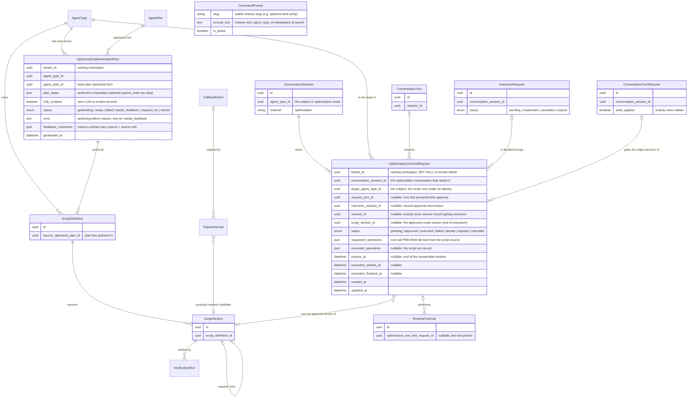

# Agent Entities — Software 3.0 Scripting

[← Agent entities hub](entities.md) · [Data model overview](../../overview.md)

Script registry and versions, optimized implementation plans, verification /
fallback / repair evidence, LLM mock recordings, and command prompts.

## Software 3.0 Script Registry, Optimized Plan & Command Prompt Entities

The two-layer plan model and the optimizer's live-test ledger: the base
`AgentPlan` stays a high-level step list; the model-authored workflow
composition lives in a separate `OptimizedImplementationPlan` produced by the
explicit "Optimize & Verify" action (its mission text is stored as a
`CommandPrompt`) or by an **optimization conversation** with the same agent type.
The composition's script segments are persisted as versioned, sandboxed
`ScriptDefinition` / `ScriptVersion` rows with verification, fallback, and
repair evidence. `OptimizationLiveTestRequest` records the operator-approved
live run of one saved script version during optimization.

**Source**: `backend/app/db/models/optimized_plan.py` — OptimizedImplementationPlan
**Source**: `backend/app/db/models/command_prompt.py` — CommandPrompt
**Source**: `backend/app/db/models/optimization_live_test.py` — OptimizationLiveTestRequest

> **Script registry evidence** (`ScriptDefinition`, `ScriptVersion`, `VerificationRun`, `FallbackEvent`, `RepairAttempt`) is shown here only as relationship context; the **Workflow Compilation** module ([`../workflow-compilation/entities.md`](../workflow-compilation/entities.md)) is its authoritative home.

| Entity | Description |
|--------|-------------|
| **OptimizedImplementationPlan** | The model-authored workflow composition for an agent type — separate from the base plan. Carries `plan_steps` (script segments, LLM bridges, output decision), the `fully_scripted` execution-semantics mark (only a fully-scripted plan is served zero-LLM; otherwise its scripts become invocable tools), status `generating` / `ready` / `failed` / `needs_feedback` / `requires_fix` / `retired`, `error` populated **only** for `needs_feedback`, and a `feedback_comments` memory included on regeneration. Served **only while `ready` and fresher than the base plan**; `needs_feedback`, `requires_fix` and `retired` are never served. Authored only by the workspace **authoring model** — unavailable (and nothing written) when that setting is unset or invalid. |
| **CommandPrompt** | A stored, named command mission (e.g. `optimize-and-verify`) that drives a special agent side execution: at launch, the mission text is used as the execution prompt (with the target agent type interpolated) instead of the agent type's own system instruction. Deliberately not a Skill/SOP — a command is a mission, not a permission-grantable capability. The same mission text is the base of an optimization conversation's instruction. |
| **OptimizationLiveTestRequest** | One operator-facing request to run a saved script **live** during optimization. Created when replay cannot prove a script or the operator explicitly asks for live verification (`pending`); `script_version_id` names the approved script version — the **script**, never an individual tool call, is the unit of approval and execution (MCP tools are assumed to work; the approval proves the script end to end). `requested_operations` is only the **tool-call preview** derived server-side from that version's source, which is what the operator sees. `status` is the domain state machine: `pending` → `approved` (consent recorded; at most one execution attempt may follow) → `executed` or `failed`; or `pending` → `denied` / `expired` / `cancelled`, all of which keep the session replay-only and are retained for audit. `executed_operations` records the **script run** actually observed (status, bounded result summary, per-tool-call outcomes, telemetry, duration) so *what ran* is comparable to *what was approved*. Decision attribution (who, when, approve/deny) is **not** duplicated here — it is read from the linked `InterveneResponse`; single-shot execution is gated by the linked `ConversationTurnResume` exactly-once marker. |

**Business rules:**
- Script-First execution preference: a `fully_scripted` optimized plan is served as a zero-LLM script; all other scripts are exposed as `script____<name>` tools the LLM orchestrates. Absent, stale, retired, **`needs_feedback`**, **`requires_fix`**, or failed optimized plans fall back to the base-plan LLM path.
- The base `AgentPlan.fully_scripted` mark flags workflows achievable by a single script (no/typed input); it seeds the optimized-plan authoring, not execution itself.
- Only Control Center persists registry, plan, and execution data; Agent Runtime consumes them exclusively via CC REST APIs.
- **One active plan per agent type.** Re-optimization retires the previous plan (kept for reference) and authors a new one with the old plan plus the full feedback memory as context.
- **`requires_fix` vs `needs_feedback`** — never conflated: `needs_feedback` is authored-side (the Optimize run could not verify a composition; reason in `error`); `requires_fix` is execution-side (a later run of the ready plan failed and fell back; set at fallback time, reason in an auto-recorded feedback entry, `error` untouched). Neither is silently re-served.
- **Feedback memory entries** are append-only JSON objects (`created_at`, `raw_feedback`, `summary`). Manual entries carry `source = "manual"`; auto-recorded ones carry `source = "execution_derived"` plus `source_execution_id` (soft reference) and optionally `source_fallback_event_id`. Missing `source` reads as `manual` (no backfill needed); a derived entry never replaces a manual one.
- Plan authoring is **explicit**: saving an agent type no longer schedules generation. "Not configured" and "no plan yet" are UI-derived states, never stored flags.
- **Optimization requires at least one successful execution** of the agent type — derived from execution records (an empty result still counts); no counter or flag exists.
- **A live-test request can only be raised inside an optimization conversation** (`channel = "optimization"`), whose `agent_type_id` is the subject; no field can repoint it, and the requested script version must belong to that subject.
- A live run executes under the **subject's** identity and permission scope — so a script naming an ungranted tool is refused before it runs.
- `requested_operations` and `script_version_id` are **immutable after creation**: an approval authorizes exactly that script once; a changed script is a new version, a new request, and a new approval.
- `approved` never implies executed evidence: only `executed`/`failed` carry timestamps and `executed_operations`; denial, silence, and expiry leave it empty.
- Replay and live evidence stay separate: `VerificationRun`/`ScriptExecutionRecord` are replay; `OptimizationLiveTestRequest` plus the `RuntimeToolCall` pointer are live (see Workflow Compilation).

**Optimization mode (no optimizer agent entity):** optimization is **not** a
separate agent. An optimization conversation *is* the subject agent type in an
optimization conversation — an ordinary `ConversationSession` bound to that
agent type (`agent_type_id` is simultaneously the runner and the subject) whose
existing free-form `channel` holds the value `"optimization"`. It runs with the
agent type's own identity, role, model, and skill bindings, so there is no
seeded optimizer `AgentType`, no identity/role/skill binding rows, and nothing
optimizer-specific for an administrator to govern. The reasoning model is
workspace configuration (`TenantSetting.optimizer_model_id`, falling back at
read time to the authoring model — see the Tenancy module), never an agent type
property. The one-shot Optimize action and the optimization conversation coexist
and share the same plan lifecycle, so a conversation never writes plan rows
directly — its outcome lands on the same `OptimizedImplementationPlan`.

**Conversation and turn state are separate entities:** the persisted activity
state (`ConversationActivity`) and the durable paused-turn records
(`ConversationTurnResume`, `ConversationTurnCheckpoint`) are documented in the
**Communication** module, which is their authoritative home.
