# Communication & Conversations — Entities

[← Data model overview](../../overview.md)

Conversations, their turns and tool activity, the persisted **activity state**
("what is the assistant doing right now"), the durable **paused-turn** records,
and human interventions. All of these are Control-Center-owned; Agent Runtime
and Communication Hub reach them only through CC internal (mTLS) APIs.

```mermaid
erDiagram
    ConversationSession {
        uuid id
        uuid agent_type_id "runs the turns; the SUBJECT when channel = optimization"
        uuid triggered_by_user_id
        uuid agent_job_id
        string title
        string channel "web | integration | optimization (free-form value, no constraint)"
        enum status "active | closed | archived | error"
        int turn_count
        datetime created_at
        datetime updated_at
        datetime closed_at
    }
    ConversationTurn {
        uuid id
        uuid session_id
        enum role
        enum turn_type "message | intervene_request | intervene_response"
        string content
        int token_count
        uuid intervene_request_id
        datetime created_at
    }
    ToolCallRecord {
        uuid id
        uuid turn_id
        string tool_name
        json tool_input
        json tool_output
        string error
        int duration_ms
        datetime created_at
    }
    RuntimeToolCall {
        uuid id
        uuid session_id "logical ref: agent job OR conversation session, no FK"
        enum session_kind "agent | conversation"
        string tool_name
        enum route_type "system | mcp | a2a"
        string mcp_slug "nullable; MCP-routed calls only"
        enum status "success | error"
        uuid optimization_live_test_request_id "nullable; set only for an approved single-use live test"
        int duration_ms "nullable"
        string error "nullable"
        datetime created_at
    }
    ConversationActivity {
        uuid id
        uuid conversation_session_id "unique; one live activity record per session"
        enum state "thinking | using_tool | delegating | waiting_for_human | finished | failed | timed_out"
        uuid current_turn_id "nullable; turn being processed"
        uuid pending_intervene_request_id "nullable; outstanding intervention while waiting_for_human"
        uuid active_resume_id "nullable; durable resume record backing the state shown"
        string tool_name "nullable; tool being called while using_tool"
        uuid target_agent_type_id "nullable; delegation target while delegating"
        json detail "nullable; state context only, never secrets"
        boolean is_terminal "true for finished | failed | timed_out"
        datetime started_at
        datetime last_updated_at "heartbeat; drives staleness detection"
        datetime finished_at "nullable; set on terminal resolution"
    }
    ConversationTurnResume {
        uuid id
        uuid tenant_id "owning tenant; resumption never leaves it"
        uuid conversation_session_id "at most one live resume record per session"
        uuid turn_id "nullable; the paused turn"
        uuid intervene_request_id "nullable; the confirmation awaiting an answer"
        enum state "waiting_for_human | resuming | resolved | unresumable"
        enum resume_outcome "approved_applied | denied | cancelled | expired | superseded | resume_failed (nullable)"
        boolean is_terminal "true when resolved or unresumable"
        string resume_key "opaque, stable handle any instance can resolve"
        string idempotency_key "unique; exactly one confirmed write per paused turn"
        boolean write_applied "set exactly once when the confirmed action landed"
        uuid applied_by_user_id "nullable; responding user the action is attributed to"
        datetime applied_at "nullable; set with write_applied"
        json applied_effect_summary "nullable; what the confirmed action changed"
        uuid outcome_turn_id "nullable; the single turn recording the outcome"
        string claimed_by_instance_id "nullable; instance currently continuing the turn"
        datetime claim_expires_at "nullable; expiry that releases the turn for failover"
        int attempt_count
        datetime last_attempt_at "nullable"
        string terminal_reason_code "nullable; why the turn is no longer resumable"
        string terminal_message_key "nullable; actionable user-facing message identity"
        datetime expires_at "nullable; end of the answerable window"
        datetime resolved_at "nullable"
        datetime created_at
        datetime updated_at
    }
    ConversationTurnCheckpoint {
        uuid id
        uuid resume_id "exactly one checkpoint per resume record"
        enum payload_kind "agent_turn_state | conversation_state"
        int schema_version "framework payload version; guards resume compatibility"
        json payload "opaque agent-framework state; never secrets"
        int payload_bytes
        boolean is_consumed "true after a successful resume rebuilt the turn"
        datetime created_at
        datetime expires_at "nullable; purge horizon"
    }
    InterveneRequest {
        uuid id
        uuid agent_session_id "nullable; NULL for conversation-scoped requests (no backing agent job)"
        uuid agent_type_id
        uuid conversation_session_id
        enum intervention_type "approval | choice | text"
        string reason
        json choices
        enum status "pending | responded | cancelled | expired"
        int delegation_depth
        datetime created_at
        datetime responded_at
        datetime expires_at
    }
    InterveneResponse {
        uuid id
        uuid request_id
        uuid operator_user_id
        boolean approval_value
        string selected_choice
        string text_value
        datetime responded_at
    }
    AgentA2ASessionLink {
        uuid id
        string requester_instance_id
        string receiver_instance_id
        string session_link_id
        enum status
        datetime created_at
        datetime disconnected_at
    }
    AgentType {
        uuid id
        string name
        enum input_type
        boolean is_active
    }
    AgentSession {
        uuid id
        uuid agent_type_id
        uuid triggered_by_user_id
        enum status
        json conversation_history
        datetime created_at
    }
    AgentJob {
        uuid id
        uuid agent_type_id
        uuid triggered_by_user_id
        uuid parent_job_id
        uuid root_job_id
        int delegation_depth
        enum status "queued | running | waiting_for_human | completed | failed | terminated"
        datetime created_at
    }
    Identity {
        uuid id
        string subject
        string display_name
    }

    AgentType ||--o{ ConversationSession : "runs (subject when channel=optimization)"
    Identity ||--o{ ConversationSession : "owns"
    ConversationSession }o--o| AgentSession : "backed by"
    ConversationSession }o--o| AgentJob : "backed by"
    ConversationSession ||--o{ ConversationTurn : "has"
    ConversationTurn ||--o{ ToolCallRecord : "invokes"
    ConversationSession ||--o| ConversationActivity : "has current activity"
    ConversationActivity }o--o| ConversationTurn : "processing turn"
    ConversationActivity }o--o| InterveneRequest : "paused awaiting"
    ConversationActivity }o--o| ConversationTurnResume : "reflects the live resume record"
    ConversationActivity }o--o| AgentType : "delegating to"
    ConversationSession ||--o{ ConversationTurnResume : "pauses turns in"
    ConversationTurnResume ||--o| ConversationTurn : "pauses and records the outcome of"
    ConversationTurnResume ||--o| InterveneRequest : "awaits the answer to"
    ConversationTurnResume ||--o| ConversationTurnCheckpoint : "checkpointed by"
    ConversationTurnResume }o--o| Identity : "attributes the applied action to"
    ConversationTurn }o--o| InterveneRequest : "references"
    InterveneRequest }o--|| ConversationSession : "surfaced in"
    InterveneRequest }o--o| AgentJob : "originates from (null for conversation-scoped)"
    InterveneRequest ||--o| InterveneResponse : "resolved by"
    InterveneResponse }o--|| Identity : "responded by"
    AgentA2ASessionLink ||--o| ConversationSession : "links delegated context"
    Identity ||--o{ AgentJob : "triggered by"
    AgentJob ||--o{ AgentJob : "delegates to (child inherits trigger)"
    AgentJob ||--o{ RuntimeToolCall : "tool executions (logical ref, no FK)"
    ConversationSession ||--o{ RuntimeToolCall : "tool executions (logical ref, no FK)"
```

**Sources**: `backend/app/db/models/conversations.py`, `backend/app/db/models/conversation_activity.py`, `backend/app/db/models/conversation_turn_resume.py`, `backend/app/db/models/intervene.py`, `backend/app/db/models/agents.py`, `backend/app/db/models/tool_calls.py`

**ConversationStatus enum values:**

| Value | Meaning |
|---|---|
| `active` | Session is open and accepting new messages |
| `closed` | User explicitly ended the session; no longer accepting messages |
| `archived` | Hidden from the active sessions list; retained for audit and history |
| `error` | Session encountered an unrecoverable error |

**ActivityState enum values** (`ConversationActivity.state`):

| Value | Meaning | Terminal |
|---|---|---|
| `thinking` | Assistant is reasoning; no tool call or delegation active | no |
| `using_tool` | Assistant is calling a tool (`tool_name` carries which) | no |
| `delegating` | Assistant delegated to another agent type (`target_agent_type_id`) | no |
| `waiting_for_human` | Assistant paused for human input (`pending_intervene_request_id`; only valid while `active_resume_id` points at a live resume record) | no |
| `finished` | Turn completed normally | yes |
| `failed` | Turn failed (including "stopped unexpectedly" after a restart) | yes |
| `timed_out` | Turn timed out or the work is no longer resumable | yes |

**ResumeState / ResumeOutcome enum values** (`ConversationTurnResume`):

| `state` | Activity state shown | Meaning |
|---|---|---|
| `waiting_for_human` | `waiting_for_human` | Paused, answerable, checkpoint available |
| `resuming` | `thinking` / `using_tool` / `delegating` | Answer accepted; work continuing on some instance |
| `resolved` | `finished` | Terminal; outcome recorded once (write applied, or nothing written) |
| `unresumable` | `timed_out` (`failed` when `resume_failed`) | Terminal; cannot be continued — actionable reason surfaced |

| `resume_outcome` | Classification | Meaning |
|---|---|---|
| `approved_applied` | resolved | Confirmed write applied exactly once |
| `denied` | resolved | Nothing written |
| `cancelled` | resolved | Deliberately ended before answering |
| `expired` | unresumable | Answered outside the answerable window |
| `superseded` | unresumable | A newer pause took over the session |
| `resume_failed` | unresumable | Checkpoint unusable |

**CheckpointPayloadKind values:** `agent_turn_state`, `conversation_state`.

| Entity | Description |
|--------|-------------|
| **ConversationSession** | Primary user-facing session entity for conversational agent interactions; tracks session title (auto-generated), user ownership, agent type, and lifecycle status (active / closed / archived / error). `channel` is a **free-form value**, not an enum: `web` for UI chat, `integration` for third-party client sessions, and `optimization` for an optimization conversation about the agent type in `agent_type_id`. |
| **ConversationTurn** | A single message within a session; carries a role label (user, agent, tool, or system) and a `turn_type` distinguishing regular `message` turns from `intervene_request` and `intervene_response` intervention events. Ordered chronologically. |
| **ToolCallRecord** | A record of a specific tool invocation made during a conversation turn — what was called, with what arguments, what was returned, and any error encountered. |
| **RuntimeToolCall** | Append-only runtime log of every tool execution performed by Agent Runtime — system tools, MCP tools, and A2A delegations — keyed to an agent job or conversation session (polymorphic `session_id`, no FK). Powers the per-node tool-call routes and history in the runtime topology. |
| **ConversationActivity** | The authoritative, persisted record of a conversational agent's current activity in a session. Exactly one live record per session (created on first activity, updated in place on every transition); `state` is the single source of truth the chat surface reads to reconstruct its indicator. `last_updated_at` is the heartbeat that drives staleness detection; `current_turn_id` and `pending_intervene_request_id` are the resume/checkpoint references; `active_resume_id` makes "shown as waiting" structurally equal to "actually answerable"; `detail` carries state-specific context only — never credentials, tokens, or decrypted secrets. Owned and written by Control Center. |
| **ConversationTurnResume** | The durable resume index for one paused conversational turn. Created when a turn pauses for human input, it ties together the session, the paused turn, the pending intervention, and the eventual terminal outcome. `resume_key` is the opaque handle any instance can resolve; `state`/`resume_outcome` make the turn's fate explicit; `idempotency_key` + `write_applied`/`applied_at` guarantee the confirmed write lands at most once; `claimed_by_instance_id` + `claim_expires_at` ensure one instance continues a given turn at a time and that failover can take it over; `outcome_turn_id` guarantees the resumed (or resolved) outcome appears exactly once in history. `expires_at` is the answerable window and mirrors the linked `InterveneRequest.expires_at`. |
| **ConversationTurnCheckpoint** | The opaque, versioned payload that lets a *different* instance rebuild the paused turn. Framework-owned serialisation with no secrets and no business semantics of its own; consumed once (`is_consumed`) and purgeable on resolution. If it is missing or unusable at resume time, the resume record resolves to `unresumable` — the index, not the payload, is authoritative for whether a turn should have been answerable. |
| **InterveneRequest** | An agent-initiated request for human intervention surfaced in a conversation session. Links to the originating `AgentJob` when there is one — `agent_session_id` is **optional**, so conversation-scoped requests (e.g. from the Control Center Assistant) carry NULL and resume from `conversation_session_id` — and to the parent `ConversationSession`. Tracks intervention type (approval, choice, text), lifecycle status, and delegation depth. |
| **InterveneResponse** | The operator's response to an `InterveneRequest`. Carries the type-specific response value (approval boolean, selected choice, or free-form text) and the responding operator identity. |
| **AgentJob** | A single provisioned agent execution tracked from submission through completion; carries trigger provenance via `triggered_by_user_id` (direct, delegated, or schedule-inherited) and delegation via `parent_job_id`/`root_job_id`. |
| **AgentA2ASessionLink** | Tracks requester/receiver linkage when one agent delegates to another in a shared session context. Supports lifecycle visibility and disconnection handling for delegated conversations. |

**Tenant containment:** conversation sessions, turns, tool-call records,
intervene requests/responses, A2A session links, activity records, and agent jobs
have no own tenant column — they inherit tenant scope through their `AgentType`
(and trigger identity). `ConversationTurnResume` does carry `tenant_id`
(durable work-in-flight must not outlive or cross its workspace) and its
resumption never leaves that tenant. Every conversation, A2A delegation, and tool
execution resolves within the exact session tenant; A2A delegation **by name**
resolves the target agent type by **(tenant, name)**. Runtime tool calls resolve
MCP slugs and system tools within the calling tenant only.

**Trigger-provenance semantics:** `triggered_by_user_id` is populated per launch path — direct user triggers set it to the triggering user's `Identity`; delegated child jobs inherit it from their parent via `parent_job_id`; schedule-triggered jobs copy it from `ScheduledJob.scheduled_by_user_id` at trigger time (the schedule **name** is shown as the trigger source). The topology projection additionally exposes `trigger_source` (`user | schedule | delegated | unknown`), `trigger_source_label`, and `trigger_user_label` — all **derived at read time**, never persisted columns on `AgentJob`. Each topology node's `tool_calls` list is the `RuntimeToolCall` history (non-A2A rows) resolved to MCP server slugs; A2A delegation rows (`route_type=a2a`) are recorded permanently but rendered as delegation edges rather than in-node tool calls.

**RuntimeToolCall notes:** `session_id` is a polymorphic **logical reference with no enforced FK** — it holds an `AgentJob` id when `session_kind=agent` and a `ConversationSession` id when `session_kind=conversation` (conversation turns execute without a backing agent job). `mcp_slug` maps to `McpServer.slug` at render time (no FK). Non-null `optimization_live_test_request_id` flags exactly the calls made by an **operator-approved, single-use live test** raised from an optimization conversation, so live contact with a real integration is distinguishable from replay verification inside the raw tool log; it is `NULL` for ordinary runs, replay verification, and normal conversation turns.

**Conversation-scoped interventions:** `InterveneRequest.agent_session_id` is optional because conversational agent types (e.g. the Control Center Assistant) execute turns without an `AgentJob`. Such requests carry `agent_session_id = NULL` and use `conversation_session_id` as the resume key; job-scoped requests still set both where a conversation exists. A `waiting_for_human` activity record links to the outstanding request via `pending_intervene_request_id`.

**Durable pause → resume chain:** `ConversationSession` → paused `ConversationTurn` → pending `InterveneRequest` → `ConversationTurnResume` → terminal `resume_outcome` (with `ConversationTurnCheckpoint` holding the framework state and `InterveneResponse` holding the answer). Rules:

- At most **one live (non-terminal) resume record per session**; a new pause closes the previous one as `superseded`.
- `state = resolved` with `resume_outcome = approved_applied` requires `write_applied = true`, `applied_at`, `applied_by_user_id`, and one `outcome_turn_id`; a denial, expiry, or cancel never sets `write_applied`.
- `idempotency_key` is globally unique per paused turn, so a duplicate or re-delivered answer is rejected rather than applied twice.
- Claim expiry only frees the turn for another instance; it never changes the state, and the terminal decision is made under the claim.
- `ConversationActivity.detail` is state context only and is never a checkpoint — durable resume state lives exclusively in `ConversationTurnResume` + `ConversationTurnCheckpoint`.

**Optimization live-test approval chain:** a `channel = "optimization"` conversation can ask the operator to run a saved script version live. The approval plumbing is generic and reused — `ConversationSession` → `ConversationTurn` → `InterveneRequest` → `InterveneResponse` — with `ConversationTurnResume` providing the exactly-once gate; the proposal and the execution evidence (approved script version, tool-call preview, decision, script run result) live in `OptimizationLiveTestRequest`, whose authoritative diagram is in the **Agents** module. Replay evidence (`VerificationRun`, `ScriptExecutionRecord`) is a separate record from the live one.
