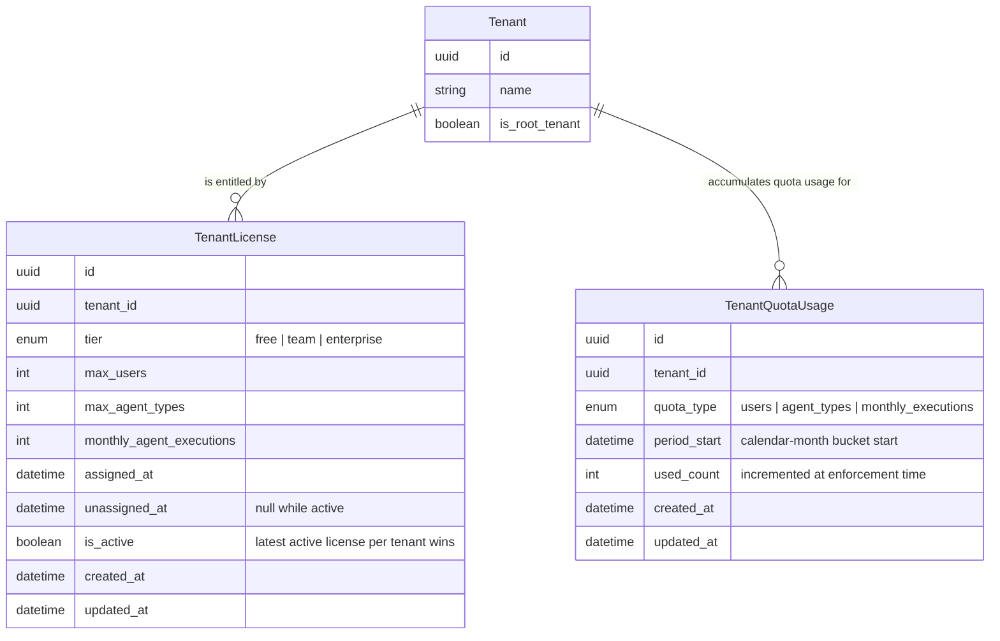

# Licensing & Quota — Entities

License-based entitlements and per-tenant quota enforcement. Licenses are assigned/changed/removed only by the platform admin and every change is audited in `TenantAuditEvent`.

| Entity | Description | Source |
|---|---|---|
| `TenantLicense` | A tenant's entitlement (tier + user / agent-type / monthly-execution limits); at most one active license per tenant — superseded licenses remain as history (`is_active = false`, `unassigned_at` set); a tenant with no active license runs on free-tier default limits | `backend/app/db/models/tenant_license.py` |
| `TenantQuotaUsage` | Per-tenant, per-quota-type usage counter bucketed by calendar month (`period_start`); unique per (tenant, quota_type, period); incremented once per accepted execution at the enforcement point | `backend/app/db/models/tenant_quota_usage.py` |

**Counting representation per quota type:**

- `users` — **derived live**: count of active `TenantUserMembership` rows for the tenant (checked at invite/creation time); no counter row.
- `agent_types` — **derived live**: count of `AgentType` records owned by the tenant (checked at creation time); no counter row.
- `monthly_executions` — **maintained counter** (`TenantQuotaUsage` row): incremented once per accepted execution at submission acceptance; a new calendar month starts a fresh bucket, so counters reset implicitly and completed/failed executions are never refunded or double-counted.
