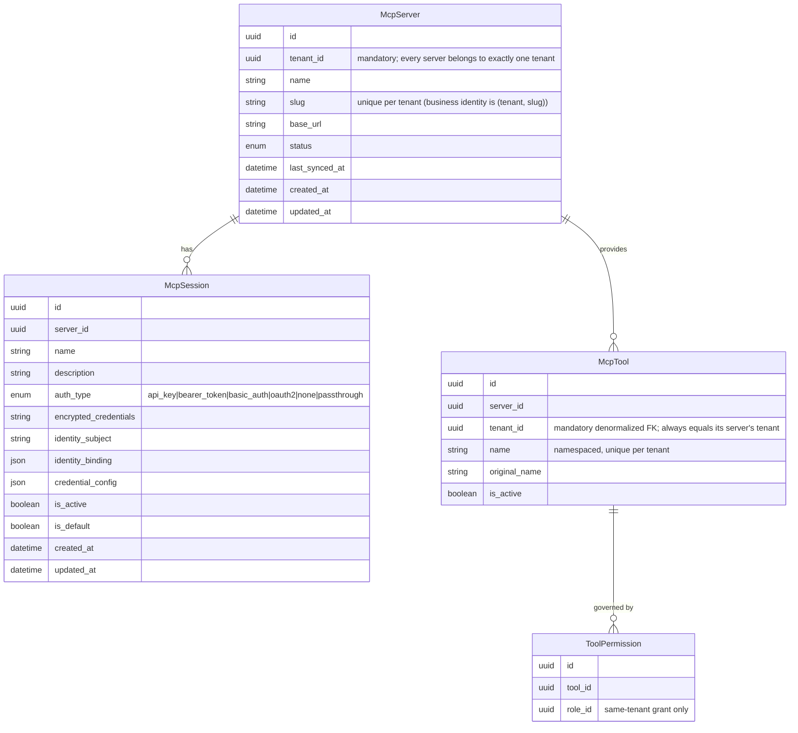
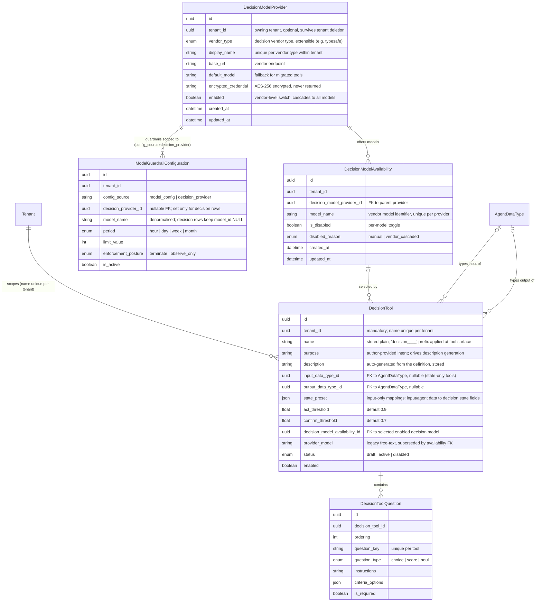

# MCP Hub — Entities

**Source**: `backend/app/db/models/mcp_hub.py`

**Business rules:**
- `McpServer.slug` is the tool namespace **within its tenant only** — two tenants may each register a server with slug `supabase`; business identity of a server is **(tenant, slug)** (platform-wide slug uniqueness is retired). Tool namespaced names (`slug/tool`) are likewise unique per tenant.
- Server display labels can change, but slug remains stable for references and namespaced tool IDs within the tenant.
- `McpTool.tenant_id` is a **denormalized, mandatory tenant stamp** (defense in depth): tool lookups in hot paths (tool naming, permission resolution, skill binding validation) prove tenant containment on the row itself without joining through the server. The server remains the source of truth; the tool's binding must always equal its server's tenant and is kept consistent by tool sync.
- Tool **permission grants** (role → tool) resolve within the granting tenant: a grant in tenant A never authorizes a tool in tenant B (roles and tools share the same tenant scope).
- At most one `McpSession` per `McpServer` may be marked `is_default = true`; a sole session is automatically treated as default. Sessions inherit tenant scope through their server (no own tenant column).

| Entity | Description |
|--------|-------------|
| **McpServer** | A tenant-owned registered external tool server with a slug unique per tenant; its status (active/inactive) is tracked by the platform. |
| **McpSession** | A named connection configuration on a server that carries a specific identity, credential binding, and session-level config for outbound calls; supports structured identity binding and per-session credential configuration. `auth_type` may be `passthrough`, in which case the executing agent's identity is forwarded at call time and no credentials are stored. `is_default` designates the session used for sync operations and default tool calls when no specific session is requested. |
| **McpTool** | A capability synced from an external server; namespaced under the server's slug, unique within the tenant, and carrying its own denormalized tenant binding. |
| **ToolPermission** | Grants a Role or Identity the right to invoke a specific tool — always within one tenant's role space. |

---

## Decision Tools (tenant-authored)

Decision tools are the tenant-authored counterpart of built-in system tools; they surface alongside system tools in listings, permission grants, and MCP tool lists without altering the system-tool entities. Tool names are unique **within a tenant only**; the stored name is plain — the `decision____<name>` prefix (four underscores, mirroring `system____`) is applied only at the tool surface (tool registry, permission grants, MCP tool list), never in storage. The tool description is **auto-generated** from the definition (questions, purpose) and is stored on the entity — that generated description is what skills, agents, and MCP clients see.

**Sources**: `backend/app/db/models/decision_tools.py`, `backend/app/db/models/system_one_provider_config.py`, `backend/app/db/models/decision_model_availability.py`, `backend/app/db/models/model_guardrail_configuration.py`

**Business rules:**
- Input and output schemas are **not stored on the tool** — `input_data_type_id` / `output_data_type_id` reference the shared `AgentDataType` registry (same tenant). Both are optional (a tool may be state-only). Referenced data types are **protected from deletion** while referenced.
- `state_preset` holds **input-only mappings** — it maps input/agent data into the decision state; the output data type is never mapped into the preset.
- **Questions are auto-derivable** from the output data type (each schema field yields a typed question); `DecisionToolQuestion` rows persist the authored, ordered form, unique per tool by `question_key`.
- **Readiness**: a decision tool is `ready` when **both** input and output data types are configured.
- Act/confirm confidence thresholds (`act_threshold` default 0.9, `confirm_threshold` default 0.7) gate the computed execution outcome; `DecisionExecutionResult` (see the Operations module) records each run.
- **Model selection**: each tool references a `DecisionModelAvailability` row (`decision_model_availability_id`); only enabled models (provider enabled + row not disabled) are selectable, and vendor-level disable cascades to all its model rows while preserving manually-disabled state. A disabled/unavailable selection surfaces an actionable error at evaluation time. The legacy free-text `provider_model` field is superseded. Provider deletion is blocked while any tool still references one of its models.
- **Guardrail scoping**: decision guardrails reuse `ModelGuardrailConfiguration` / `ModelUsagePosture` with `config_source='decision_provider'` and a nullable `decision_provider_id` FK (`model_id` stays NULL on decision rows); the LLM (`model_config`) and decision scopes never mix.

| Entity | Description |
|--------|-------------|
| **DecisionModelProvider** | Multi-vendor decision model provider registry (formerly the single "System One Provider"; table identity unchanged). Stores AES-256 encrypted credentials and a vendor-level `enabled` switch that cascades to its models; `display_name` is unique per vendor type within a tenant. |
| **DecisionModelAvailability** | Per-model enable/disable row under a provider, mirroring the LLM `ModelAvailability` pattern; `disabled_reason` records `manual` vs `vendor_cascaded`, and re-enabling a provider clears cascaded rows while preserving manual disables. |
| **DecisionTool** | Tenant-authored decision tool; selects an enabled decision model and gates execution via act/confirm thresholds. `decision_model_availability_id` is the structured model selection (legacy `provider_model` free text superseded). |
| **DecisionToolQuestion** | Authored, ordered question row per tool, unique by `question_key`; auto-derivable from the output data type's schema fields. |
| **ModelGuardrailConfiguration** (decision scope) | Usage guardrail per (provider, model, period) with `config_source='decision_provider'`; partial unique index `(decision_provider_id, model_name, period)`. LLM guardrails share the table via `config_source='model_config'`. |
