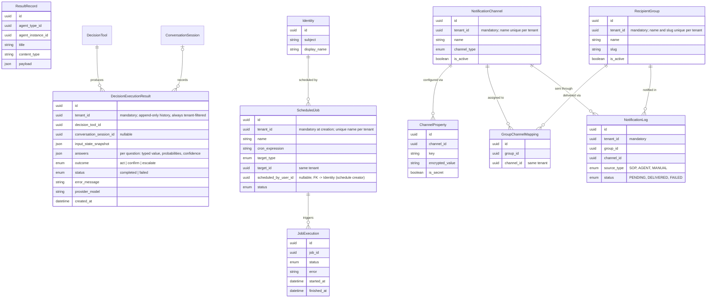

# Results, Scheduling & Notifications — Entities

All entities below carry a **mandatory tenant binding**: every row belongs to exactly one tenant (when multi-tenancy is disabled, everything binds to the root tenant — never tenant-less). Retrieval, dispatch, and query paths match the exact calling tenant only; there is no shared/global slot and no fallback.

**Sources**: `backend/app/db/models/results.py`, `backend/app/db/models/scheduling.py`, `backend/app/db/models/notifications.py`, `backend/app/db/models/decision_tools.py`, `backend/app/db/models/identity.py`

| Entity | Description |
|--------|-------------|
| **ResultRecord** | A structured output saved by an agent or SOP via the `save_data` tool; accessible through the result repository. |
| **DecisionExecutionResult** | Append-only audit record of each decision-tool execution: input state snapshot, per-question typed answers with probabilities and confidence, and the computed gate outcome (`act` / `confirm` / `escalate`). Scoped to the owning tenant of the decision tool. |
| **ScheduledJob** | A cron-based schedule that triggers an agent execution; **tenant-bound at creation**, and dispatch never falls back through `job → agent type` chains across tenants — each job executes under its owning tenant's context. |
| **JobExecution** | A record of a single run of a ScheduledJob; inherits tenant scope via its parent job. |
| **NotificationChannel** | A configured outbound destination for notifications; type is one of: email, Slack, Teams, or webhook. Name unique per tenant. |
| **RecipientGroup** | A named, tenant-bound audience; agents and SOPs target a group by `slug`, resolved within the calling tenant only (name and slug unique per tenant). |
| **GroupChannelMapping** | Many-to-many association between recipient groups and channels; both sides share the same tenant. |
| **NotificationLog** | Immutable, tenant-attributed delivery record per channel attempt, including delivery outcome and error detail. |

**Dispatch tenant binding:** notification dispatch resolves the recipient group and its channel mappings within the calling tenant only. The global NULL-tenant "shared slot" is no longer a dispatch target, and channel lookup by id also verifies tenant containment.
