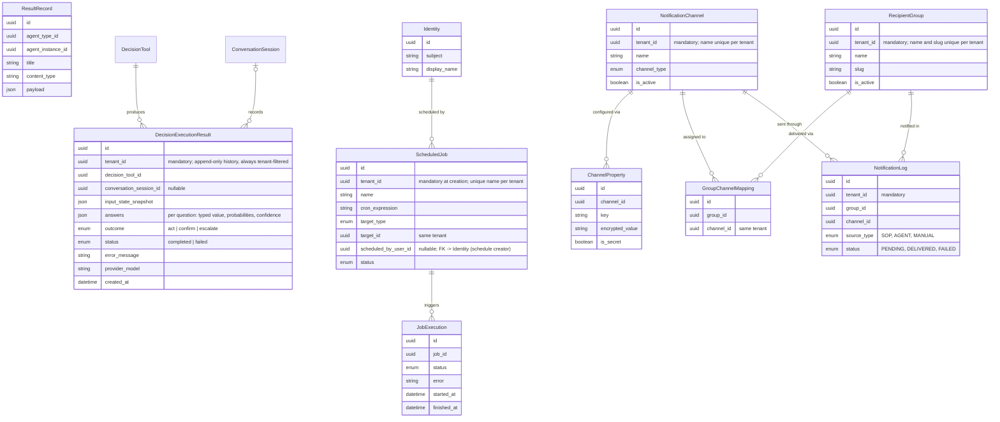
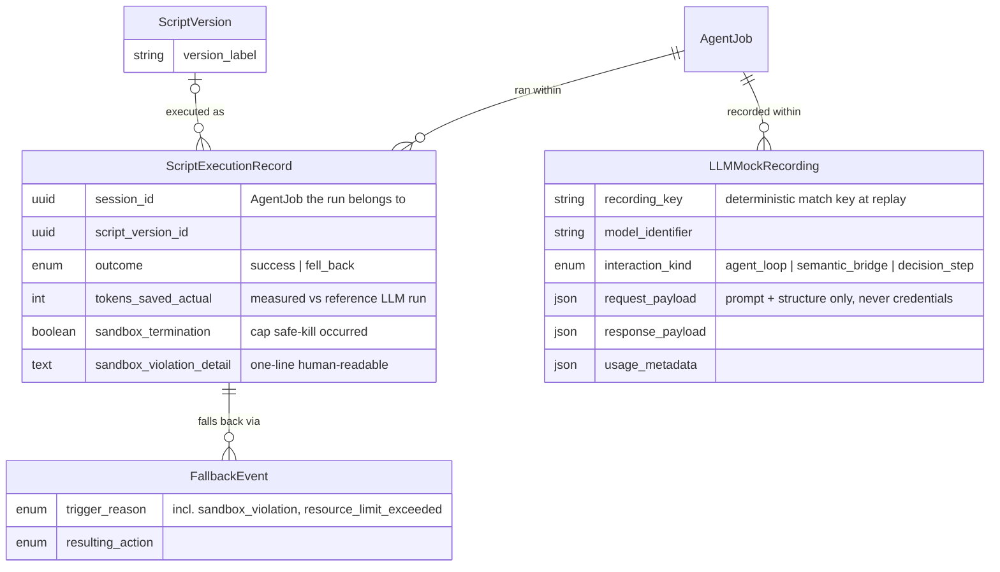

# Results, Scheduling & Notifications — Entities

All entities below carry a **mandatory tenant binding**: every row belongs to exactly one tenant (when multi-tenancy is disabled, everything binds to the root tenant — never tenant-less). Retrieval, dispatch, and query paths match the exact calling tenant only; there is no shared/global slot and no fallback.

**Sources**: `backend/app/db/models/results.py`, `backend/app/db/models/scheduling.py`, `backend/app/db/models/notifications.py`, `backend/app/db/models/decision_tools.py`, `backend/app/db/models/identity.py`

| Entity | Description |
|--------|-------------|
| **ResultRecord** | A structured output saved by an agent or SOP via the `save_data` tool; accessible through the result repository. |
| **DecisionExecutionResult** | Append-only audit record of each decision-tool execution: input state snapshot, per-question typed answers with probabilities and confidence, and the computed gate outcome (`act` / `confirm` / `escalate`). Scoped to the owning tenant of the decision tool. |
| **ScheduledJob** | A cron-based schedule that triggers an agent execution; **tenant-bound at creation**, and dispatch never falls back through `job → agent type` chains across tenants — each job executes under its owning tenant's context. |
| **JobExecution** | A record of a single run of a ScheduledJob; inherits tenant scope via its parent job. |
| **NotificationChannel** | A configured outbound destination for notifications; type is one of: email, Slack, Teams, or webhook. Name unique per tenant. |
| **RecipientGroup** | A named, tenant-bound audience; agents and SOPs target a group by `slug`, resolved within the calling tenant only (name and slug unique per tenant). |
| **GroupChannelMapping** | Many-to-many association between recipient groups and channels; both sides share the same tenant. |
| **NotificationLog** | Immutable, tenant-attributed delivery record per channel attempt, including delivery outcome and error detail. |

**Dispatch tenant binding:** notification dispatch resolves the recipient group and its channel mappings within the calling tenant only. The global NULL-tenant "shared slot" is no longer a dispatch target, and channel lookup by id also verifies tenant containment.

## Script Execution & LLM Mock Recording Entities

Per-execution provenance for scripted workflow runs and test-infrastructure
recordings of LLM interactions. Both are Control-Center-owned; Agent Runtime
writes them via CC REST APIs only.

**Source**: `backend/app/db/models/script_execution.py` — ScriptExecutionRecord
**Source**: `backend/app/db/models/llm_mocking.py` — LLMMockRecording

| Entity | Description |
|--------|-------------|
| **ScriptExecutionRecord** | One row per scripted execution (whole-script or script-segment run) within an AgentJob. Records the outcome (success or LLM fallback), the script version served, **measured** `tokens_saved_actual` (real tokens avoided versus the reference LLM run — the legacy `tokens_saved_estimate` remains only on historical rows), and sandbox failure provenance: `sandbox_termination` marks cap safe-kills and `sandbox_violation_detail` carries a one-line human-readable reason (no truncated JSON blobs). Tenant-scoped (`SET NULL`). |
| **LLMMockRecording** | A recorded LLM request/response pair captured in record mode for deterministic replay and prompt assertions in tests. Keyed by `recording_key` (deterministic hash of the request); identical inputs replay identically. Test-infrastructure data: written only in test/recording modes, related to the capturing AgentJob/session but unrelated to ScriptVersion, and carries **prompt + response + usage only — never API keys or identity tokens**. Tenant-scoped (`SET NULL`). |
