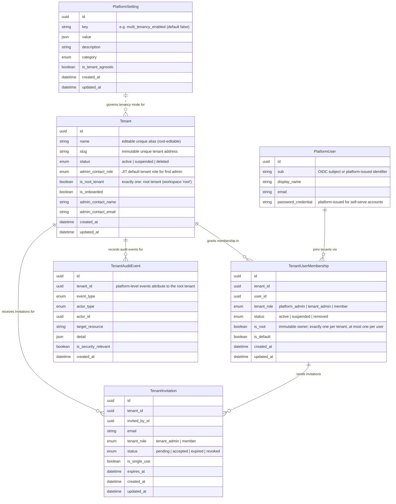

# Tenancy — Entities

Multi-tenant core (opt-in, disabled by default via the `multi_tenancy_enabled` switch in `PlatformSetting`). The former system tenant is the **root tenant** (workspace name/address `root`, `is_root_tenant = true`): it adopts pre-existing data at migration and hosts platform staff as ordinary members with platform roles.

| Entity | Description | Source |
|---|---|---|
| `Tenant` | Organization workspace; `name` is the editable unique alias, `slug` the immutable address; exactly one tenant has `is_root_tenant = true` (the root tenant, workspace `root`); `admin_contact_role` is the JIT default role granted to the first admin | `backend/app/db/models/tenant.py` |
| `TenantUserMembership` | A user's presence in a tenant with a tenant-scoped role; `is_root` marks the immutable owner (one per tenant, at most one owned tenant per user, root implies all tenant permissions, alterations rejected and audited) | `backend/app/db/models/tenant_membership.py` |
| `TenantInvitation` | Pending user onboarding into a tenant; carries target tenant role, single-use flag, and expiry | `backend/app/db/models/tenant_invitation.py` |
| `TenantAuditEvent` | Tenant-attributed audit trail for lifecycle, registration, root-protection, licensing, and quota events; platform-level events attribute to the root tenant | `backend/app/db/models/tenant_audit_event.py` |
| `PlatformSetting` | Tenant-agnostic platform configuration store; home of the `multi_tenancy_enabled` switch (default `false`) | `backend/app/db/models/platform_setting.py` |
| `PlatformUser` | Tenant-agnostic real-world person; tenant presence via memberships; platform-issued email + password credential for self-serve accounts | `backend/app/db/models/platform_user.py` |

**Self-serve registration:** one all-or-nothing action creates `PlatformUser` + `Tenant` + the creator's root `TenantUserMembership` (`is_root = true`), then lands the root user in guided onboarding; a user who already owns a tenant is blocked (one owned tenant per user).
