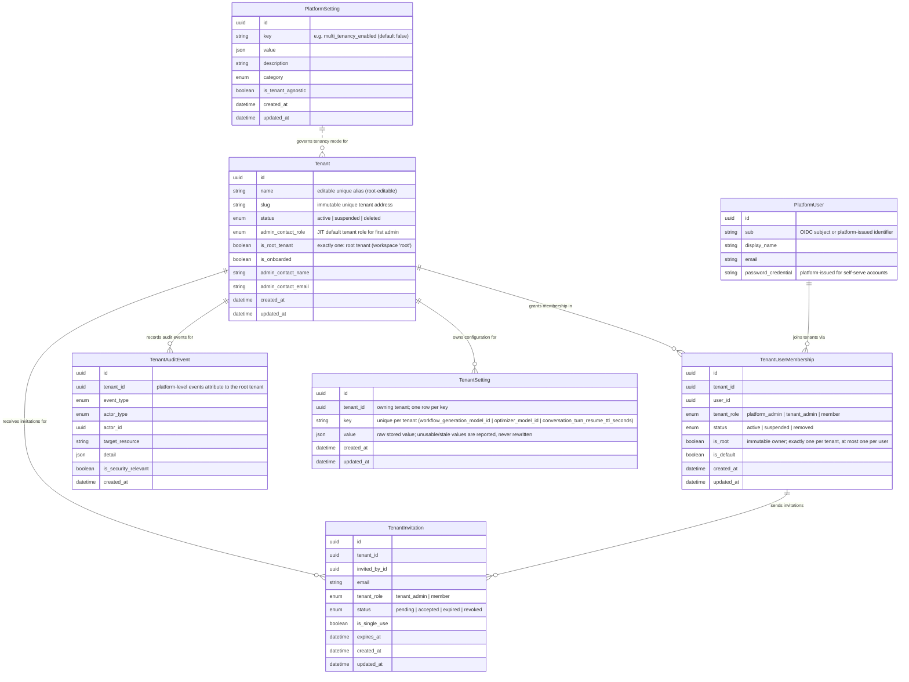

# Tenancy — Entities

[← Data model overview](../../overview.md)

Multi-tenant core (opt-in, disabled by default via the `multi_tenancy_enabled` switch in `PlatformSetting`). The former system tenant is the **root tenant** (workspace name/address `root`, `is_root_tenant = true`): it adopts pre-existing data at migration and hosts platform staff as ordinary members with platform roles.

**Strict tenant containment — the shared-slot concept is retired:** every data-plane business entity (skills, SOPs, agent roles/identities/types, model configs, agent data/outputs/data types, decision tools, recipient groups, notification channels, scheduled jobs, tag definitions, policy grants, MCP servers/tools) belongs to **exactly one tenant**. There is no NULL-tenant "platform-shared" slot: legacy NULL-tenant rows are **adopted once into the root tenant** (idempotent one-time migration), and the `tenant IS NULL OR tenant = own` lookup pattern is removed everywhere — only exact tenant matching remains. Fail-open tenant resolution is likewise retired: an unbound context is a hard error, never a default. When multi-tenancy is disabled, everything binds to the root tenant and behavior is identical, never tenant-less.

**Sources**: `backend/app/db/models/tenant.py`, `backend/app/db/models/tenant_membership.py`, `backend/app/db/models/tenant_invitation.py`, `backend/app/db/models/tenant_audit_event.py`, `backend/app/db/models/platform_setting.py`, `backend/app/db/models/tenant_setting.py`, `backend/app/db/models/platform_user.py`

**Two configuration stores:** `PlatformSetting` is **tenant-agnostic** (globally unique by key, e.g. `multi_tenancy_enabled`); `TenantSetting` is **tenant-scoped** (one row per tenant + key, so different tenants may hold different values for the same key). Tenant settings are always read and written within the session tenant only, and are removed with their tenant.

**Workspace resolution for settings:** a setting value always resolves for the **session tenant**. When multi-tenancy is disabled — and for context-free work such as startup and background jobs — it resolves for the **root tenant**, the default workspace. There is no second global setting to keep in sync and no cross-workspace fallback.

**Models configured per workspace:** two keys name LLM models, and both are resolved **at read time** — no resolved model is ever persisted, and a stale selection is never normalised away.

| Key | Meaning |
|---|---|
| `workflow_generation_model_id` | The workspace's single **authoring model**. Three consumers: Skill/SOP workflow generation, base implementation-plan (`AgentPlan`) generation, and optimized-plan (`OptimizedImplementationPlan`) authoring. The **agent type's runtime `model_id` never authors plans**. |
| `optimizer_model_id` | The model that powers the **optimization conversation** for a subject agent type. |

**Authoring-model selection rules:**

- The value is a **reference into the tenant's own enabled model catalogue**, not an enforced relationship — a model identifier that must appear in the tenant's `ModelConfig.enabled_models`.
- **"Not configured / re-select" is derived, never stored**: an empty value, or an identifier no longer in the enabled list (or whose provider config is disabled), is computed on read. No flag or status row exists, and the setting row is left untouched so the earlier choice stays visible.
- **No fallback model**: when the authoring model is missing or unusable, generation is unavailable — no plan is written — and the last successful plan is preserved. Nothing is ever written back into the setting.
- Only Control Center resolves these values (it alone reads PostgreSQL); Agent Runtime and Communication Hub receive model identifiers through the internal agent-context endpoint.

**Optimizer-model selection rules:**

- Resolution order at read time: an explicit `optimizer_model_id` that resolves in the enabled catalogue → the **authoring model** (`workflow_generation_model_id`) → a structured not-configured reason.
- There is deliberately **no fallback to the subject agent type's runtime model** and no first-available config; an unusable explicit selection is reported as *not enabled* rather than silently replaced or inherited.
- The fallback is derived per read — it is never written back as a second stored value, and clearing `optimizer_model_id` returns the workspace to inheriting the authoring model.
- Both keys are sibling rows in the same per-tenant store, so changing the optimizer model never mutates an agent type's runtime configuration.

**Turn-resume window:** `conversation_turn_resume_ttl_seconds` optionally overrides the platform default answerable window for a paused conversational turn (minimum 30s); the effective value is what Control Center stamps on the durable resume record and checkpoint.

**Permission containment invariant:** role and policy grants apply **only within their owning tenant**; wildcard grants (`agent::*`, `system::*`, `*::*`) are shorthand *within* one tenant's role space and never cross tenant boundaries. `platform::` grants exist **only in the root tenant's role space**, held by root-tenant members with platform roles. No customer-tenant role carries `platform::` grants; no root-tenant role addresses another tenant's business data. Root memberships (`is_root`) cannot be changed, demoted, or removed by anyone — rejected attempts are recorded as `root_protection_rejected` audit events.

| Entity | Description | Source |
|---|---|---|
| `Tenant` | Organization workspace; `name` is the editable unique alias, `slug` the immutable address; exactly one tenant has `is_root_tenant = true` (the root tenant, workspace `root`); `admin_contact_role` is the JIT default role granted to the first admin | `backend/app/db/models/tenant.py` |
| `TenantUserMembership` | A user's presence in a tenant with a tenant-scoped role; `is_root` marks the immutable owner (one per tenant, at most one owned tenant per user, root implies all tenant permissions, alterations rejected and audited) | `backend/app/db/models/tenant_membership.py` |
| `TenantInvitation` | Pending user onboarding into a tenant; carries target tenant role, single-use flag, and expiry | `backend/app/db/models/tenant_invitation.py` |
| `TenantAuditEvent` | Tenant-attributed audit trail for lifecycle, registration, root-protection, licensing, and quota events; platform-level events attribute to the root tenant | `backend/app/db/models/tenant_audit_event.py` |
| `PlatformSetting` | Tenant-agnostic platform configuration store; home of the `multi_tenancy_enabled` switch (default `false`) | `backend/app/db/models/platform_setting.py` |
| `TenantSetting` | Tenant-scoped key/value configuration store; exactly one row per **(tenant, key)**, so each tenant holds its own value. Keys today: the workspace **authoring model** (`workflow_generation_model_id` — used by Skill/SOP workflow generation, base implementation plans and optimized-plan authoring), the **optimizer model** (`optimizer_model_id` — falls back to the authoring model at read time), and the optional turn-resume window (`conversation_turn_resume_ttl_seconds`). Replaced the former global `config/app.yaml` model value | `backend/app/db/models/tenant_setting.py` |
| `PlatformUser` | Tenant-agnostic real-world person; tenant presence via memberships; platform-issued email + password credential for self-serve accounts | `backend/app/db/models/platform_user.py` |

**Self-serve registration:** one all-or-nothing action creates `PlatformUser` + `Tenant` + the creator's root `TenantUserMembership` (`is_root = true`), then lands the root user in guided onboarding; a user who already owns a tenant is blocked (one owned tenant per user).

**Software 3.0 script-framework tables:** `script_definitions`, `script_versions`, `verification_runs`, `fallback_events`, `repair_attempts`, `script_execution_records`, `llm_mock_recordings`, `optimized_implementation_plans`, `optimization_live_tests`, and `conversation_turn_resumes` all follow the platform `tenant_id` FK pattern (`SET NULL` on tenant delete), keeping registry, execution, live-test, and resume data tenant-scoped while never blocking tenant deletion.
