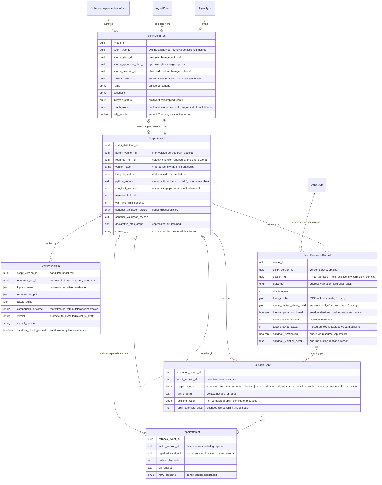

# Workflow Compilation (Script Registry) — Entities

Model-authored, sandboxed workflow scripts and their lifecycle evidence:
definitions, immutable versions, verification runs, execution records,
fallback events, and repair attempts. All entities are Control-Center-owned
(`tenant_id` FK, `SET NULL`); Agent Runtime consumes them exclusively via
mTLS Control Center REST APIs. Lifecycle is `draft → verified → compiled → retired`;
script version content is immutable. There is **no execution-mode
configuration** — script-first execution with unconditional LLM fallback is
fixed platform behavior, not configuration.

**Sources**: `backend/app/db/models/script_registry.py` — ScriptDefinition, ScriptVersion, VerificationRun, FallbackEvent, RepairAttempt · `backend/app/db/models/script_execution.py` — ScriptExecutionRecord

| Entity | Description |
|--------|-------------|
| **ScriptDefinition** | The registry's primary entity — a versioned, named bridge script compiled from an agent workflow. Belongs to exactly one Agent Type whose identity/permissions it inherits (no credentials of its own). Carries lifecycle status, lineage to the base plan / optimized plan / observed session, the current serving version pointer, and aggregate health derived from recent fallback behavior. |
| **ScriptVersion** | An immutable revision of a Script Definition. Carries the model-authored sandboxed Python content with per-version resource caps, sandbox-validation outcome, parent version lineage, distinct repair lineage (`repaired_from`), and the producing actor. |
| **VerificationRun** | Evidence record of shadow-running a Script Version against a recorded LLM execution on identical inputs: retained input/expected/actual, comparison outcome within declared tolerance, and the promote/reject verdict with reason. Rejection returns the version to draft. |
| **ScriptExecutionRecord** | One execution of a compiled script (or its fallback run), bound to an Agent Job whose identity/permission context is always passed — the script never authenticates independently. Records outcome, duration, tools invoked, model-backed steps used, identity-parity evidence, and measured token savings. |
| **FallbackEvent** | Recorded whenever a script run failed and execution fell back to the LLM path. Fallback is unconditional and mode-independent. Captures trigger reason, failure detail, resulting action, and the contribution to the script's health degradation. |
| **RepairAttempt** | One bounded, agent-driven repair cycle within a fallback episode: defect diagnosis, diff applied, retry outcome, and the optional successor Script Version produced (which must re-verify before promotion). Budget exhaustion triggers unconditional fallback. |

**Business rules:**
- Script version content and resource caps are immutable per version; lifecycle progresses `draft → verified → compiled → retired`.
- A repair-produced candidate version carries `repaired_from` lineage (separate from generic parent lineage) so defect-driven repair chains are auditable, and must pass verification before promotion to compiled.
- Aggregate `health_status` on the Script Definition degrades with repeated fallback events.
- Only Control Center persists registry and execution data; Agent Runtime consumes them exclusively via Control Center REST APIs.
