# Data Model Overview

Parthenon's data model is organised into the following domains. Each section below contains the entity-relationship diagram for that domain with key business attributes. Cross-domain links are summarised in the last section.

For entity descriptions, see the module docs in `docs/master/data-model/modules/`.
Schema source files live in `backend/app/db/models/`.

> **Multi-tenancy (default off):** the `multi_tenancy_enabled` switch lives in `PlatformSetting`. When enabled, nearly every business entity carries a tenant reference (direct on primary business entities; join tables and child records inherit scope via their parent). **Strict tenant containment** holds on the data plane: every business entity belongs to **exactly one tenant** — there is no NULL-tenant "shared/global" slot; the `tenant IS NULL OR tenant = own` lookup pattern is removed everywhere and only exact tenant matching remains. Legacy NULL-tenant rows are **adopted once into the root tenant** (idempotent one-time migration), and fail-open tenant resolution is gone — an unbound context is a hard error. The former system tenant is the **root tenant** (workspace name/address `root`, `is_root_tenant = true`): it adopts all pre-existing data at migration, hosts platform staff as ordinary members holding platform roles, and is the exclusive home of `platform::` grants — **legacy global (tenant-less) roles are migrated into it**, retiring the global role variant. The **permission containment invariant** holds everywhere: role/policy grants apply only within their owning tenant; wildcard grants never cross tenant boundaries. See the Tenancy and Licensing & Quota sections below.

---

## Tenancy (Multi-Tenant Core)

Multi-tenancy is **disabled by default** (the `multi_tenancy_enabled` switch lives in `PlatformSetting`); when off, tenant references are unused (empty or pointed at the implicit **root tenant**) and behavior is identical to the single-tenant product. Exactly one tenant carries `is_root_tenant = true` — the **root tenant** (workspace name/address `root`), which adopts all pre-existing data when multi-tenancy is enabled and hosts platform staff as **ordinary members holding platform roles** (`platform_admin` surfaced through root-tenant membership). Legacy global (tenant-less) roles — e.g. the wildcard-grant `system_admin` role — are **migrated into the root tenant** at adoption, retiring the global role variant: every business role belongs to a tenant.

`Tenant.name` is the **editable unique alias** (root-editable display name); `Tenant.slug` is the **immutable unique tenant address**. `admin_contact_role` is the JIT (just-in-time) default tenant role granted to the first admin on tenant creation/registration. **Self-serve registration** creates `PlatformUser` (platform-issued email + password credential) + `Tenant` + the creator's immutable root `TenantUserMembership` (`is_root = true`) in one all-or-nothing action; a user may own at most one tenant.

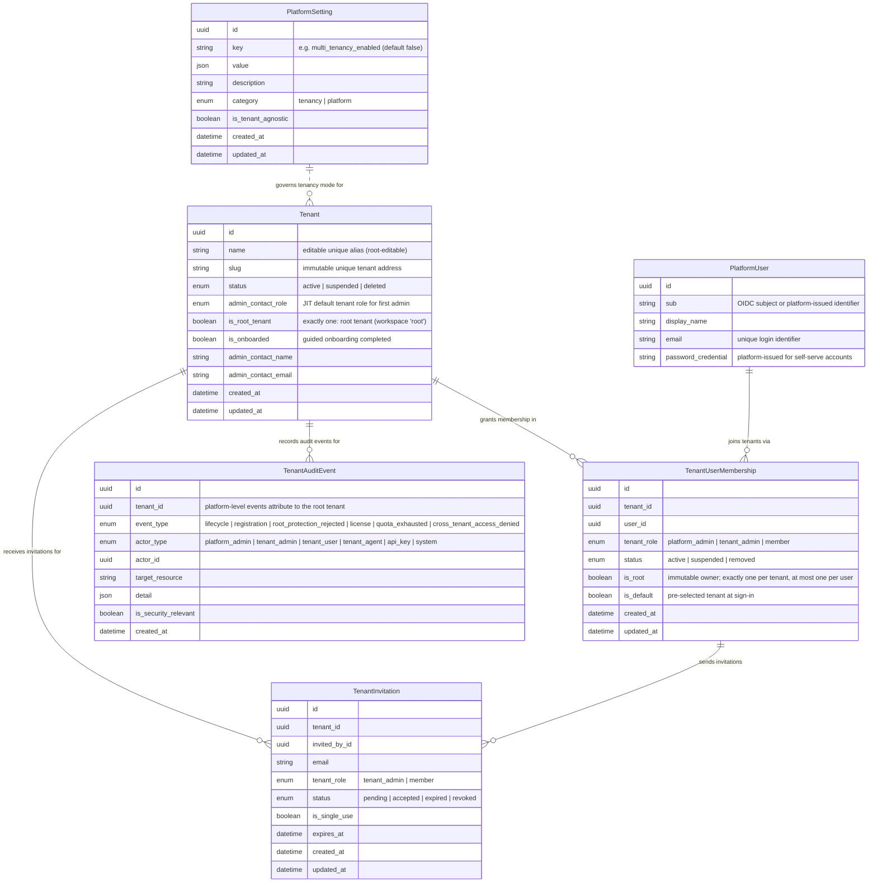

**Permission containment invariant**: role and policy grants apply **only within their owning tenant**; wildcard grants (`agent::*`, `system::*`, `*::*`) are shorthand *within* one tenant's role space and never cross tenant boundaries. `platform::` grants exist **only in the root tenant's role space**, held by root-tenant members with platform roles. No customer-tenant role carries `platform::` grants; no root-tenant role addresses another tenant's business data. Root memberships (`is_root`) cannot be changed, demoted, or removed by anyone — rejected attempts are recorded as `root_protection_rejected` audit events.

**Sources**: `backend/app/db/models/tenant.py`, `backend/app/db/models/tenant_membership.py`, `backend/app/db/models/tenant_invitation.py`, `backend/app/db/models/tenant_audit_event.py`, `backend/app/db/models/platform_setting.py`, `backend/app/db/models/platform_user.py`

---

## Licensing & Quota

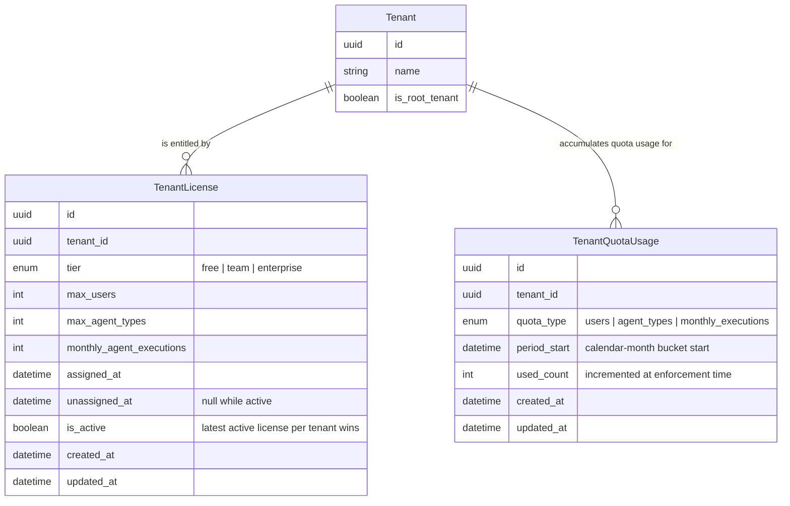

**Licensing semantics:** at most one active license per tenant (superseded licenses are kept as history with `is_active = false`); a tenant with **no active license runs on free-tier default limits**. Counting representation per quota type: `users` and `agent_types` are **derived live** from active memberships and `AgentType` record counts; `monthly_executions` is the only **maintained counter** (`TenantQuotaUsage` row per tenant + calendar-month bucket, incremented once per accepted execution — new months start a fresh bucket, so counters reset implicitly).

**Sources**: `backend/app/db/models/tenant_license.py`, `backend/app/db/models/tenant_quota_usage.py`

---

## Identity & Access

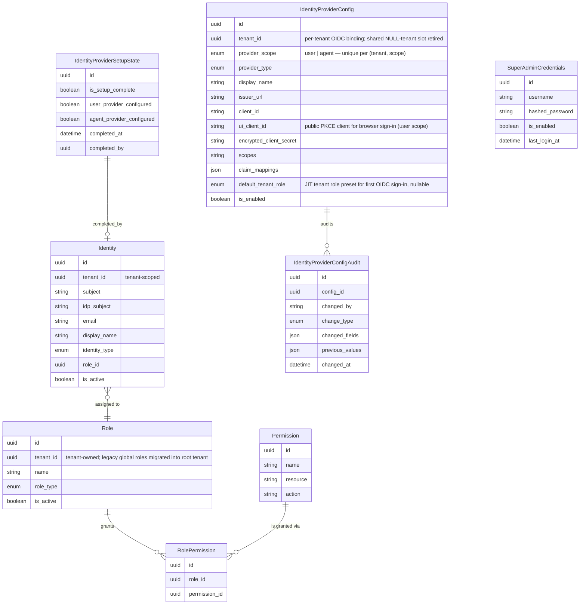

> **Tenancy notes:** `Permission` remains a **global catalogue** (not tenant-scoped) — grants are tenant-local via roles. `IdentityProviderConfig` is **strictly per-tenant**: each (tenant, scope) slot holds at most one provider (`UNIQUE (tenant_id, provider_scope)`; NULLs-distinct, so the retired legacy shared NULL-tenant slot is covered by a separate partial unique index on `provider_scope WHERE tenant_id IS NULL` pending adoption into the root tenant). There is **no shared dispatch slot**: token validation matches the exact session tenant only — a credential issued by tenant A's provider is rejected outside tenant A. All roles (including migrated legacy global roles) are **tenant-owned**, with grants contained within their owning tenant.

**Sources**: `backend/app/db/models/identity.py`, `backend/app/db/models/identity_provider_config.py`, `backend/app/db/models/identity_provider_config_audit.py`, `backend/app/db/models/identity_provider_setup_state.py`, `backend/app/db/models/super_admin_credentials.py`

---

## User Permissions

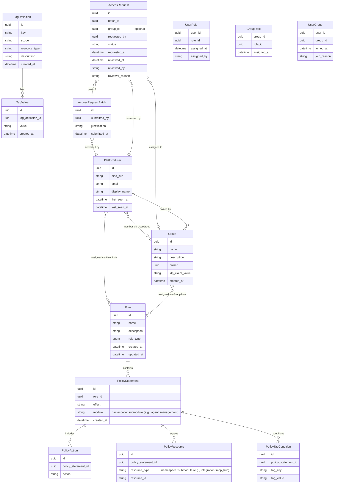

> **Module::submodule naming convention**: `PolicyStatement.module` and `PolicyResource.resource_type` use a two-layer namespaced format (`module::submodule`, e.g. `agent::management`). There are three modules: `agent` (12 submodules — roles, identities, management, runtime_control, skills, sops, model_configs, schedules, trails, human_intervention, data_types, outputs), `integration` (mcp_hub, notifications), and `system` (observability, permissions, system_config). Wildcards are supported: `*::*` matches all resource types across all modules, and `module::*` matches all submodules within a given module. Legacy flat values (e.g. `agent`, `role`, `skill`, `mcp_server`) are no longer accepted — they have been migrated to their namespaced equivalents. Validation is enforced at the application layer via `ResourceTypeManifest`.

**Sources**: `backend/app/db/models/tag_definition.py`, `backend/app/db/models/tag_value.py`, `backend/app/db/models/role.py`, `backend/app/db/models/policy_statement.py`, `backend/app/db/models/policy_action.py`, `backend/app/db/models/policy_resource.py`, `backend/app/db/models/policy_tag_condition.py`, `backend/app/db/models/platform_user.py`, `backend/app/db/models/user_role.py`, `backend/app/db/models/group.py`, `backend/app/db/models/group_role.py`, `backend/app/db/models/user_group.py`, `backend/app/db/models/access_request_batch.py`, `backend/app/db/models/access_request.py`

> **Tenant scoping:** `Role`, `PolicyStatement`, `PolicyAction`, `PolicyResource`, `Group`, `AccessRequest`, `AccessRequestBatch`, and `TagDefinition` carry a **mandatory** tenant reference (no NULL rows after adoption); `UserRole`, `GroupRole`, `UserGroup`, and `PolicyTagCondition` inherit scope via their parents. **Legacy global roles are migrated to the root tenant**: pre-tenancy tenant-less `Role` rows (e.g. the wildcard-grant `system_admin` global role) are re-homed in the root tenant's role space at adoption, so no global (tenant-less) roles remain and the role tenant reference is mandatory for all business roles. The containment invariant applies to every grant, including wildcards: no grant crosses tenant boundaries; tag keys resolve only within their owning tenant; `platform::` grants exist only in the root tenant's role space.

---

## MCP Hub

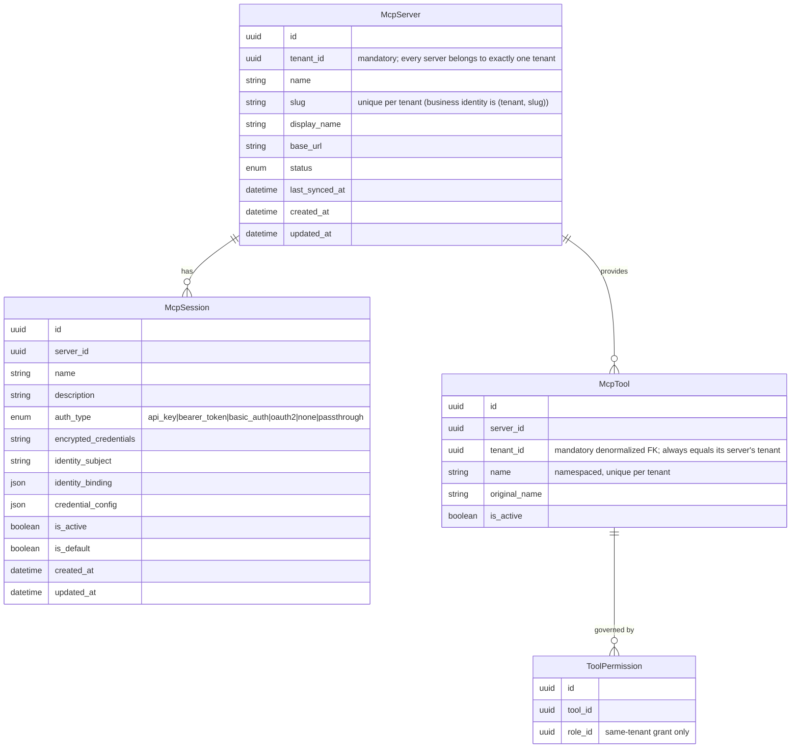

**Business rules:**
- `passthrough` sessions forward the executing agent's identity to the MCP server at call time; no credentials are stored or required.
- `slug` is the tool namespace **within its tenant only** — two tenants may each register a server with slug `supabase`; business identity of a server is **(tenant, slug)** (platform-wide slug uniqueness is retired). Tool namespaced names (`slug/tool`) are likewise unique per tenant.
- `McpTool.tenant_id` is a denormalized, mandatory tenant stamp (defense in depth for hot-path lookups); it must always equal its server's tenant and is kept consistent by tool sync.
- Tool **permission grants** resolve within the granting tenant: a grant in tenant A never authorizes a tool in tenant B (roles and tools share the same tenant scope).
- At most one `McpSession` per `McpServer` may be marked `is_default = true`; a sole session is automatically treated as default. Sessions inherit tenant scope through their server.

**Source**: `backend/app/db/models/mcp_hub.py`

---

## Skills & SOPs

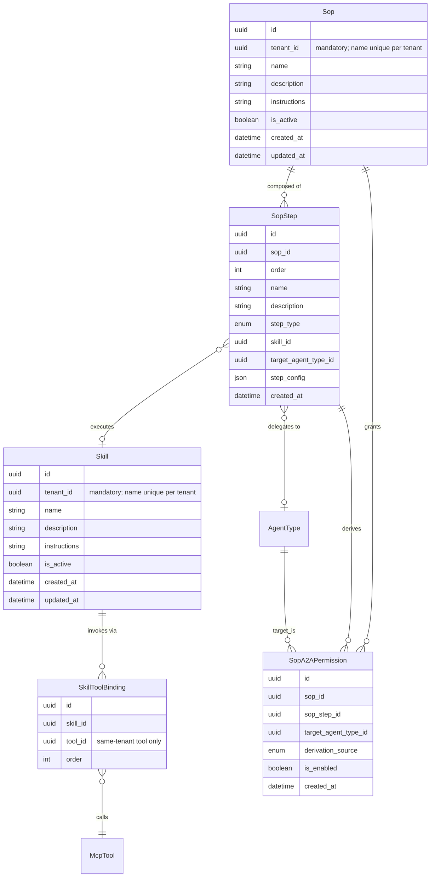

**Source**: `backend/app/db/models/skills.py`

**Tenant containment:** `Skill` and `Sop` names are unique **per tenant only** (the NULL-tenant global uniqueness variant is retired). Bindings resolve within the tenant: a skill may only bind tools of its own tenant; SOP delegation steps resolve the target agent type by **(tenant, name)**.

> **Skill versioning**: The `Skill.updated_at` timestamp is surfaced to MCP clients via the `load_skills` response. External agents use this to cache skill definitions locally and only re-download skills whose `updated_at` is newer than their cached copy.

---

## Agent Management

```mermaid
erDiagram
    ModelConfig {
        uuid id
        uuid tenant_id "mandatory; display_name unique per tenant"
        string name
        enum provider_type "12 providers — 4 incumbent (openai, anthropic, litellm_proxy, azure_openai) + 8 new (gemini, mistral, cohere, groq, together, fireworks, perplexity, deepseek). Adding a new value is a release-led activity."
        string api_endpoint
        string api_key_encrypted
        json enabled_models
        boolean is_active
        datetime created_at
        datetime updated_at
    }
    AgentRole {
        uuid id
        uuid tenant_id "mandatory; name unique per tenant"
        string name
        string description
        string slug
        datetime created_at
        datetime updated_at
    }
    AgentRoleAllowedType {
        uuid id
        uuid agent_role_id
        uuid allowed_agent_type_id
        datetime created_at
    }
    AgentRoleIdentity {
        uuid role_id
        uuid identity_id
        datetime assigned_at
        uuid assigned_by
        datetime created_at
    }
    AgentRoleSOP {
        uuid role_id
        uuid sop_id
    }
    AgentRoleSkill {
        uuid role_id
        uuid skill_id
    }
    AgentRoleMcpSession {
        uuid role_id
        uuid mcp_session_id
        uuid server_id
        datetime assigned_at
        uuid assigned_by
    }
    AgentIdentity {
        uuid id
        uuid tenant_id "mandatory; name unique per tenant"
        string name
        enum identity_type
        string auth_provider
        string realm_name
        string access_token_encrypted
        string refresh_token_encrypted
        string encrypted_refresh_token
        datetime token_expiry
        datetime last_token_refresh_at
        enum status
        enum token_status
        datetime created_at
        datetime updated_at
    }
    AgentType {
        uuid id
        uuid tenant_id "mandatory; name unique per tenant"
        string name
        string slug
        string display_name
        string description
        uuid identity_id "same tenant"
        uuid role_id "same tenant"
        string model_id
        string system_instruction
        enum input_type
        json input_schema
        enum output_type
        json output_schema
        uuid output_data_type_id "optional; linked when output_type=typed"
        boolean is_active
        datetime created_at
        datetime updated_at
    }
    AgentTypeSopBinding {
        uuid id
        uuid agent_type_id
        uuid sop_id
        int order
        datetime created_at
    }
    AgentTypeSkillBinding {
        uuid id
        uuid agent_type_id
        uuid skill_id
        int order
        datetime created_at
    }
    AgentSession {
        uuid id
        uuid agent_type_id
        uuid triggered_by_user_id
        uuid output_id "optional; convenience link"
        json input_data
        enum status "queued | running | waiting_for_human | completed | failed | terminated"
        datetime started_at
        datetime completed_at
        json output_data
        json conversation_history
        string error_message
        datetime created_at
    }
    AgentA2ASessionLink {
        uuid id
        string requester_instance_id
        string receiver_instance_id
        string session_link_id
        boolean receiver_is_dynamic
        enum status
        datetime created_at
        datetime disconnected_at
    }
    AgentData {
        uuid id
        uuid tenant_id "mandatory; retrieval matches the calling tenant only"
        uuid agent_type_id
        uuid session_id
        string data_name
        json data_value
        enum data_type
        boolean is_active
        datetime timestamp
    }
    AgentOutput {
        uuid id
        uuid tenant_id "mandatory; typed queries match the calling tenant only"
        uuid data_type_id
        uuid agent_type_id
        uuid execution_session_id
        json field_values "values keyed by field name per the data type schema"
        enum validation_status "valid | validation_error"
        string raw_output "unstructured fallback when validation fails"
        datetime created_at
    }
    AgentDataType {
        uuid id
        uuid tenant_id "mandatory; no platform-shared types"
        string name "unique per tenant"
        string slug "unique per tenant; canonical query_result identifier"
        string description
        json fields "typed field definitions; enum fields carry {value, description} entries"
        datetime created_at
        datetime updated_at
    }

    AgentRole ||--o{ AgentRoleSOP : "grants access to"
    AgentRole ||--o{ AgentRoleSkill : "grants access to"
    AgentRole ||--o{ AgentRoleIdentity : "can be assumed by"
    AgentRole ||--o{ AgentRoleMcpSession : "provides MCP context via"
    AgentRole ||--o{ AgentRoleAllowedType : "allows"
    AgentType ||--o{ AgentRoleAllowedType : "listed as"
    AgentIdentity ||--o{ AgentRoleIdentity : "can assume"
    AgentPlan {
        uuid id
        uuid agent_type_id
        json plan_steps
        json topology
        enum generation_status
        string generation_error
        string agent_config_hash
        datetime generated_at
        datetime created_at
        datetime updated_at
    }

    AgentType }o--|| AgentRole : "governed by"
    AgentType }o--|| AgentIdentity : "authenticates as"
    AgentSession }o--|| AgentType : "executes"
    AgentType ||--o{ AgentA2ASessionLink : "participates via runtime instances"
    AgentType ||--o| AgentPlan : "has current plan"
    AgentType ||--o{ AgentInstanceCertificate : "issues"
    AgentType ||--o{ AgentTypeSopBinding : "binds SOPs via"
    AgentType ||--o{ AgentTypeSkillBinding : "binds skills via"
    AgentTypeSopBinding }o--|| Sop : "references"
    AgentTypeSkillBinding }o--|| Skill : "references"
    AgentIdentity ||--o{ TokenRefreshLog : "logs"
    AgentType ||--o{ AgentData : "saves named data"
    AgentSession ||--o{ AgentData : "contains saved records"
    AgentType ||--o{ AgentOutput : "produces final output"
    AgentSession ||--o| AgentOutput : "result stored in"
    AgentDataType ||--o{ AgentOutput : "defines schema for"
    AgentType }o--|| AgentDataType : "output schema defined by"
```

**Sources**: `backend/app/db/models/agents.py`, `backend/app/db/models/agent_data.py`, `backend/app/db/models/agent_output.py`, `backend/app/db/models/agent_data_type.py`, `backend/app/db/models/agent_security.py`

**Tenant containment:** `AgentRole`, `AgentIdentity`, `AgentType`, `ModelConfig`, `AgentData`, `AgentOutput`, and `AgentDataType` carry a **mandatory** tenant reference; names and slugs are unique per tenant only (NULL-tenant global variants retired). Bindings resolve within the tenant: agent type → skill/SOP bindings and role grants on tools/skills/SOPs are same-tenant only; SOP delegation steps and A2A delegation **by name** resolve the target agent type by **(tenant, name)** — a name collision across tenants never routes to the wrong tenant's agent. Agent data saves and typed output queries (`get_data`, `get_output`, `query_result`) match the calling tenant only.

### Agent Execution Data Flow

Saved data (AgentData) is intermediate and optional — the `save_data` tool may be called zero or more times per session. Output (AgentOutput) is the final, singular result per session, produced once at execution completion.

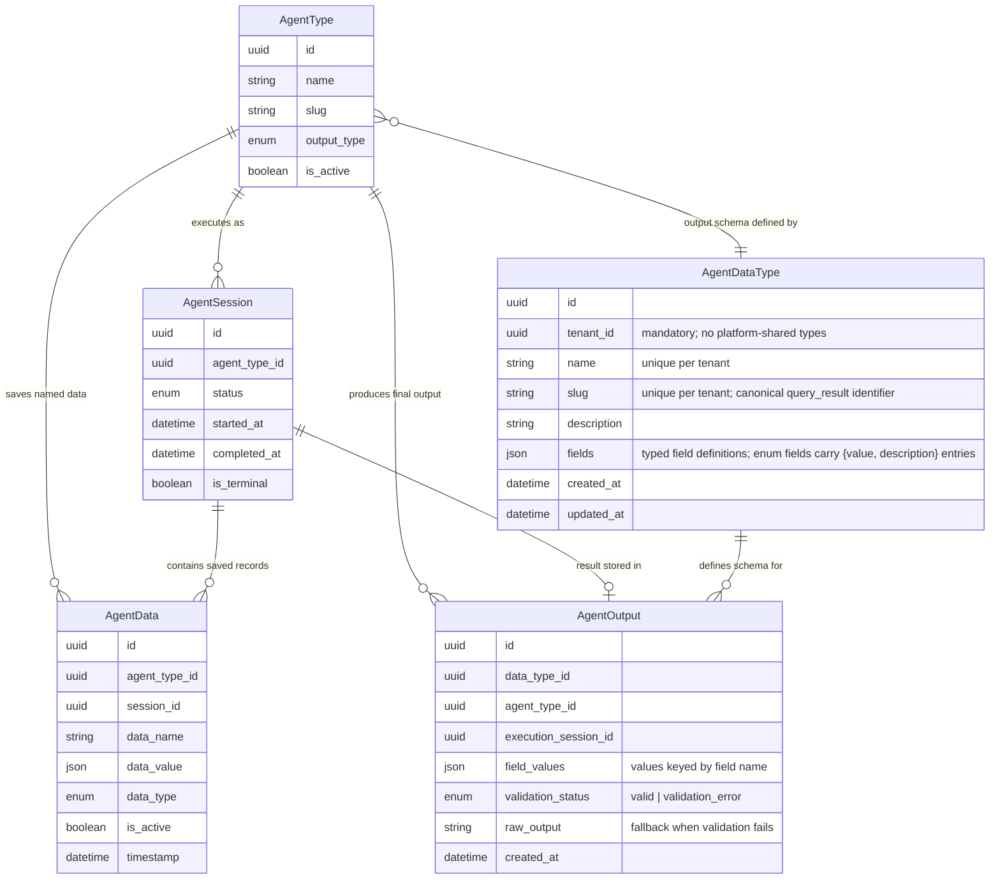

**Source**: `backend/app/db/models/agent_data.py`, `backend/app/db/models/agent_output.py`, `backend/app/db/models/agent_data_type.py`

---

## Decision Tools

Tenant-authored decision tools — the decision-making counterpart of built-in system tools. They mirror system-tool conventions (name, description, tenant scoping, `decision____<name>` prefix applied only at the tool surface) so skills, agents, SOPs, roles/permissions, and MCP exposure work with the existing tool consumption model. Tool names are unique **within a tenant only**; resolution is strictly per-tenant.

Each tool selects an **enabled decision model** from a multi-vendor **Decision Model Provider** registry (formerly the single "System One Provider"); the selection resolves at evaluation time to a provider + model pair. Guardrail configuration on decision models reuses the LLM guardrail tables via a `config_source` scope discriminator.

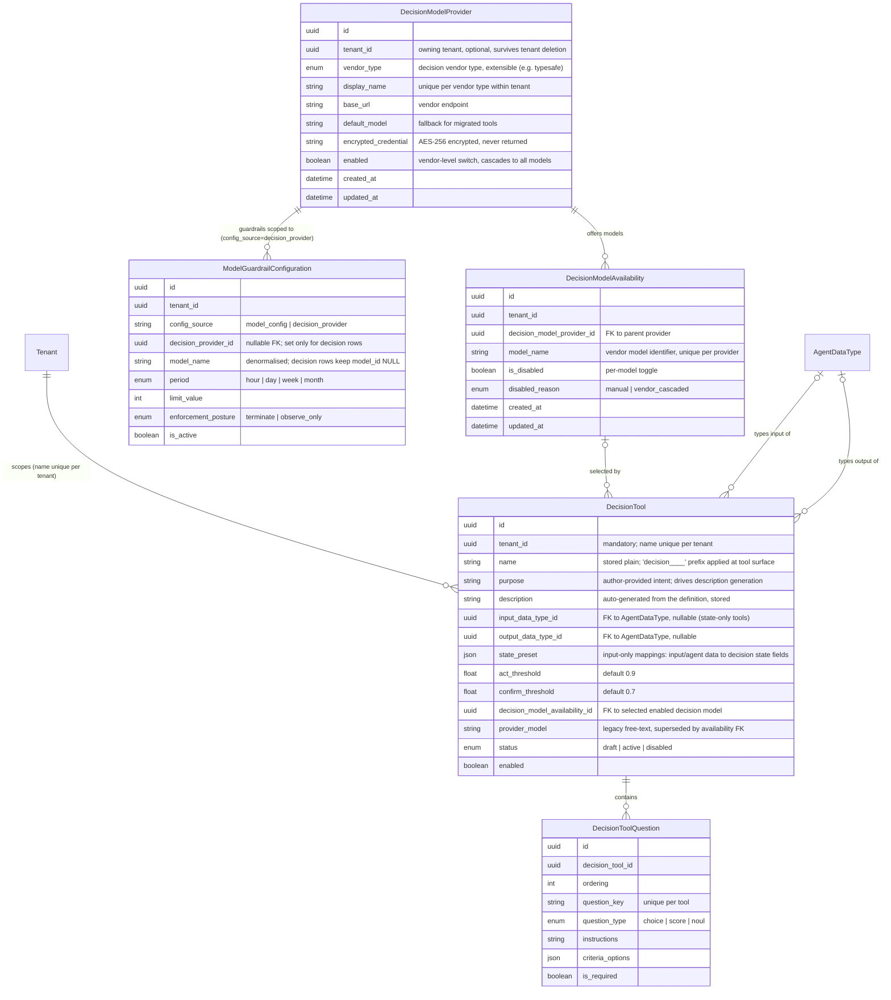

**Business rules:**
- **Model selection is structured**: a tool references a `DecisionModelAvailability` row and only enabled models (provider enabled + row not disabled) are selectable; a vendor-level disable cascades to all its model rows while preserving manually-disabled state. Disabled/unavailable selections surface an actionable error at evaluation time. The free-text `provider_model` field is legacy only.
- Deletion of a provider is blocked while any decision tool still references one of its models.
- **Guardrail scoping**: `ModelGuardrailConfiguration` and `ModelUsagePosture` rows carry `config_source` (`model_config` for LLM vendors, `decision_provider` for decision providers); decision rows keep `model_id` NULL and set the nullable `decision_provider_id` FK, with a partial unique index on `(decision_provider_id, model_name, period)`. The LLM and decision scopes never mix in either direction.
- `state_preset` holds **input-only mappings** — it maps input/agent data into the decision state; output data types are never mapped into the preset.
- **Questions are auto-derivable** from the tool's output data type (each schema field yields a typed question); `DecisionToolQuestion` rows persist the authored/ordered form, unique per tool by `question_key`.
- **Readiness**: a decision tool is `ready` when **both** input and output data types are configured (`input_data_type_id` + `output_data_type_id` non-null).
- Input/output schemas are **not stored inline** — they reference the shared `AgentDataType` registry, which protects referenced types from deletion.
- Referenced data types must belong to the same tenant; execution results (`DecisionExecutionResult`, see Results) are tenant-filtered append-only history.

**Sources**: `backend/app/db/models/decision_tools.py`, `backend/app/db/models/system_one_provider_config.py`, `backend/app/db/models/decision_model_availability.py`, `backend/app/db/models/agent_data_type.py`, `backend/app/db/models/model_guardrail_configuration.py`

---

## Agent Runtime Security

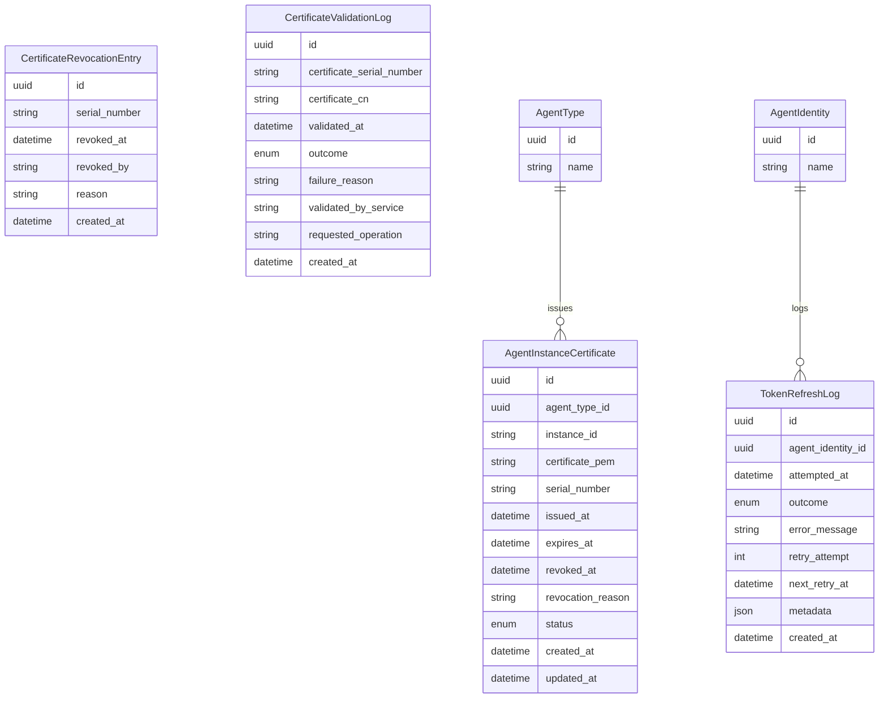

**Sources**: `backend/app/db/models/agent_security.py`

### API Key Access

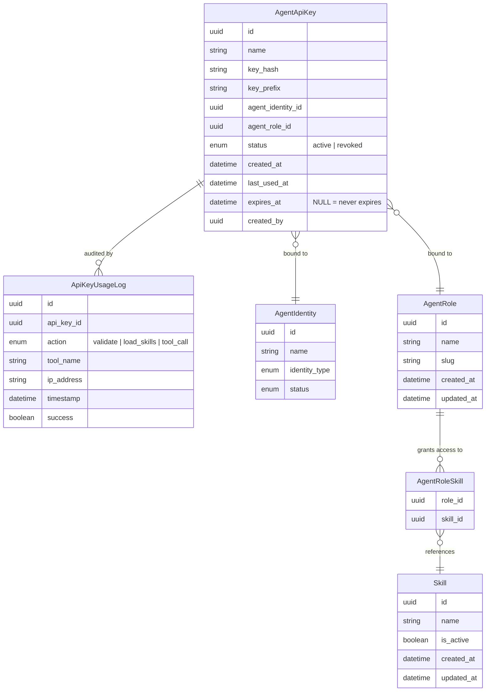

**Source**: `backend/app/db/models/agent_api_key.py`

**Business rules:**
- Keys inherit the full permission set of the bound `AgentRole` — no per-tool or per-SOP scoping on the key itself.
- One active key per identity-role pair at a time; `status` is `active` or `revoked`.
- `key_hash` uses SHA-256; the raw key is never stored after creation.
- `key_prefix` identifies the key type visually (e.g. `phn_sk_`) without exposing the secret.
- `last_used_at` is updated on each successful authentication.
- `expires_at` optionally sets a key expiry; `NULL` means the key never expires, and a past value causes the key to be rejected at authentication.
- `ApiKeyUsageLog` entries are append-only and capture the action type, tool name (when applicable), client IP, and success/failure for every API key operation.

---

## Communication, Conversations & Runtime Topology

```mermaid
erDiagram
    ConversationSession {
        uuid id
        uuid agent_type_id
        uuid triggered_by_user_id
        uuid agent_job_id
        string title
        string channel
        enum status
        int turn_count
        datetime created_at
        datetime updated_at
        datetime closed_at
    }
    ConversationTurn {
        uuid id
        uuid session_id
        enum role
        enum turn_type
        string content
        int token_count
        uuid intervene_request_id
        datetime created_at
    }
    ToolCallRecord {
        uuid id
        uuid turn_id
        string tool_name
        json tool_input
        json tool_output
        string error
        int duration_ms
        datetime created_at
    }
    RuntimeToolCall {
        uuid id
        uuid session_id "logical ref: agent job OR conversation session, no FK"
        enum session_kind "agent|conversation"
        string tool_name
        enum route_type "system|mcp|a2a"
        string mcp_slug "nullable; MCP-routed calls only"
        enum status "success|error"
        int duration_ms "nullable"
        string error "nullable"
        datetime created_at
    }
    InterveneRequest {
        uuid id
        uuid agent_session_id
        uuid agent_type_id
        uuid conversation_session_id
        enum intervention_type
        string reason
        json choices
        enum status
        int delegation_depth
        datetime created_at
        datetime responded_at
        datetime expires_at
    }
    InterveneResponse {
        uuid id
        uuid request_id
        uuid operator_user_id
        boolean approval_value
        string selected_choice
        string text_value
        datetime responded_at
    }
    AgentJob {
        uuid id
        uuid agent_type_id
        uuid triggered_by_user_id
        uuid parent_job_id
        uuid root_job_id
        int delegation_depth
        enum status "queued|running|waiting_for_human|completed|failed|terminated"
        datetime created_at
    }
    Identity {
        uuid id
        string subject
        string display_name
    }
    AgentA2ASessionLink {
        uuid id
        string requester_instance_id
        string receiver_instance_id
        string session_link_id
        boolean receiver_is_dynamic
        enum status
        datetime created_at
        datetime disconnected_at
    }

    ConversationSession ||--o{ ConversationTurn : "contains"
    ConversationTurn ||--o{ ToolCallRecord : "invokes"
    ConversationTurn }o--o| InterveneRequest : "references"
    InterveneRequest }o--|| ConversationSession : "surfaced in"
    InterveneRequest }o--|| AgentJob : "originates from"
    InterveneRequest ||--o| InterveneResponse : "resolved by"
    InterveneResponse }o--|| Identity : "responded by"
    ConversationSession }o--o| AgentJob : "backed by"
    AgentA2ASessionLink ||--o| ConversationSession : "links delegated execution context"
    Identity ||--o{ AgentJob : "triggered by"
    AgentJob ||--o{ AgentJob : "delegates to (child inherits trigger)"
    AgentJob ||--o{ RuntimeToolCall : "tool executions (logical ref, no FK)"
    ConversationSession ||--o{ RuntimeToolCall : "tool executions (logical ref, no FK)"
```

**Source**: `backend/app/db/models/conversations.py`, `backend/app/db/models/intervene.py`, `backend/app/db/models/agents.py`, `backend/app/db/models/tool_calls.py`

**Runtime topology projection:** Per execution node, the topology API exposes `trigger_source` (`user | schedule | delegated | unknown`), `trigger_source_label`, and `trigger_user_label` — all **derived at read time**, never persisted columns. `trigger_source=user` resolves `AgentJob.triggered_by_user_id` to its `Identity.display_name`; `trigger_source=delegated` inherits the parent job's trigger source via `AgentJob.parent_job_id`; `trigger_source=schedule` uses the schedule **name** as `trigger_source_label` and — when the creator is known — the `ScheduledJob.scheduled_by_user_id` creator's display name as `trigger_user_label`. Each node's `tool_calls` list is the runtime tool-call history (from `RuntimeToolCall`, non-A2A rows) resolved to MCP server slugs; A2A delegation rows (`route_type=a2a`) are recorded permanently in `runtime_tool_calls` but rendered as delegation edges rather than in-node tool calls.

---

## Results, Scheduling & Notifications

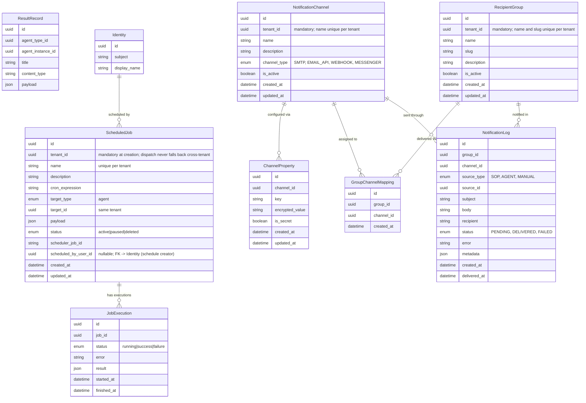

**Entity notes:**
- `NotificationChannel` — a configured outbound destination (SMTP relay, Email API, webhook endpoint, or Instant Messenger connector). One channel can serve multiple recipient groups.
- `ChannelProperty` — individual key-value configuration for a channel. Secret properties (`is_secret=true`) are encrypted at rest and never returned in API responses.
- `RecipientGroup` — a named, addressable audience. Agents and SOPs target a group by `slug`; the platform resolves all assigned channels and delivers to each.
- `GroupChannelMapping` — many-to-many association between recipient groups and channels.
- `NotificationLog` — immutable delivery record per channel attempt. Records source (`SOP`, `AGENT`, or `MANUAL`), delivery status, and any error detail.

**Dispatch tenant binding:** recipient groups, channels, and their mappings are tenant-bound; dispatch resolves the group and its channel mappings within the calling tenant only. The global NULL-tenant "shared slot" is no longer a dispatch target, and channel lookup by id also verifies tenant containment.

**Sources**: `backend/app/db/models/results.py`, `backend/app/db/models/scheduling.py`, `backend/app/db/models/notifications.py`, `backend/app/db/models/identity.py`

---

## Cross-Domain Relationship Map

> **Cross-domain tenant isolation:** everything below resolves within the exact session tenant only — no cross-tenant fallback, sharing, or visibility. Tool names (`slug/tool`), A2A and SOP delegation **by name**, data type slug/name resolution (`query_result`), notification dispatch (recipient group → channels), skill/SOP/agent-type binding validation, and role permission grants (including wildcards) are all **tenant-scoped**. When multi-tenancy is disabled, everything binds to the root tenant — behavior is identical, never tenant-less.

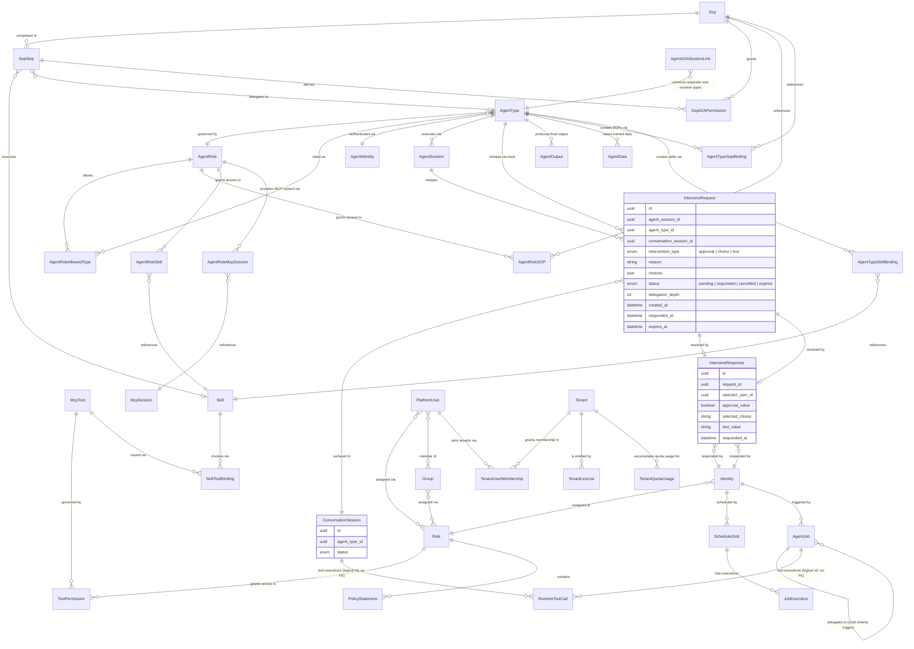
