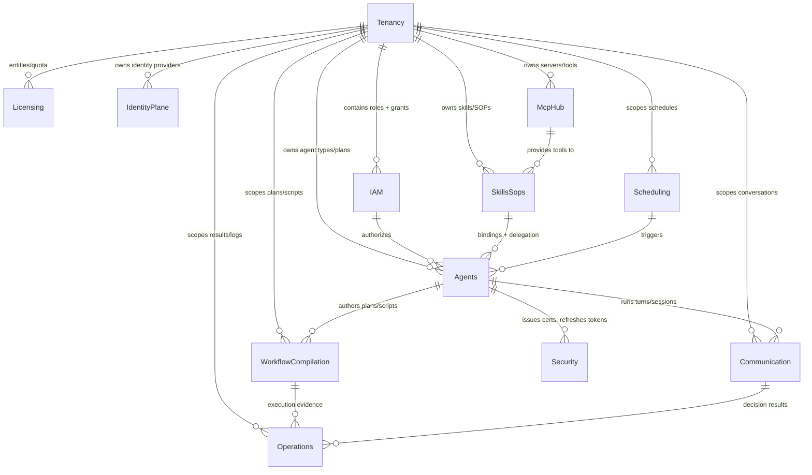

# Data Model Overview

Parthenon's entity model is split into domain modules. This page is the **hub**:
it shows how the domains relate and links to each module page, which holds that
domain's authoritative entity-relationship diagram and entity descriptions.

Schema source files live in `backend/app/db/models/` (`source.schema` in
`easyspec-config.yaml`). **Ownership boundary:** only Control Center connects to
the database. Agent Runtime and Communication Hub reach persisted state
exclusively through Control Center internal (mTLS) APIs.

---

## Cross-Domain Relationship Map

Domain-to-domain links only — each box is a module page, not an entity.

**Cross-domain invariants** (detail per module):

- **Strict tenant containment:** every business entity belongs to exactly one
  tenant; grants, name resolution, dispatch, and reads match the exact session
  tenant only. No NULL-tenant shared slot, no fail-open resolution. When
  multi-tenancy is disabled everything binds to the **root tenant** (default
  workspace `root`) — behaviour is identical, never tenant-less.
- **Permission containment:** role/policy grants apply only inside their owning
  tenant; `platform::` grants exist only in the root tenant's role space.
- **Conversation entities have no own tenant column** — they inherit scope via
  their `AgentType`; durable turn records (`ConversationTurnResume`) do carry
  `tenant_id` because they outlive a single request.

---

## Domain Modules

| Domain | Scope | Module page |
|---|---|---|
| Tenancy | Workspaces, memberships, invitations, audit, per-tenant settings | [`modules/tenancy/entities.md`](modules/tenancy/entities.md) |
| Licensing & Quota | License tiers, quota counters | [`modules/licensing/entities.md`](modules/licensing/entities.md) |
| Identity | Identity providers, principals, super admin, brand/role catalogue | [`modules/identity/entities.md`](modules/identity/entities.md) |
| IAM & Policy | Roles, policy statements, groups, tags, access requests | [`modules/iam/entities.md`](modules/iam/entities.md) |
| MCP Hub | MCP servers/sessions/tools, tool grants, decision tools + providers | [`modules/mcp-hub/entities.md`](modules/mcp-hub/entities.md) |
| Skills & SOPs | Skills, tool bindings, SOP steps, A2A permissions | [`modules/skills/entities.md`](modules/skills/entities.md) |
| Agents | Agent types/roles/identities, plans, live tests, clients — plus [`runtime control & guardrails`](modules/agents/runtime-control.md) and [`Software 3.0 scripting`](modules/agents/scripting.md) | [`modules/agents/entities.md`](modules/agents/entities.md) |
| Workflow Compilation | Script registry, versions, verification, fallback/repair evidence | [`modules/workflow-compilation/entities.md`](modules/workflow-compilation/entities.md) |
| Communication | Conversation sessions/turns, activity state, resume records, interventions | [`modules/communication/entities.md`](modules/communication/entities.md) |
| Operations | Results, decision executions, notification delivery, script execution/mock logs | [`modules/operations/entities.md`](modules/operations/entities.md) |
| Scheduling | Cron schedules and job executions | [`modules/scheduling/entities.md`](modules/scheduling/entities.md) |
| Security | Instance certificates, revocation, token refresh/health, API keys | [`modules/security/entities.md`](modules/security/entities.md) |

Each module page opens with its entity-relationship diagram and `**Source**`
line naming the schema files, then entity descriptions and business rules.
